

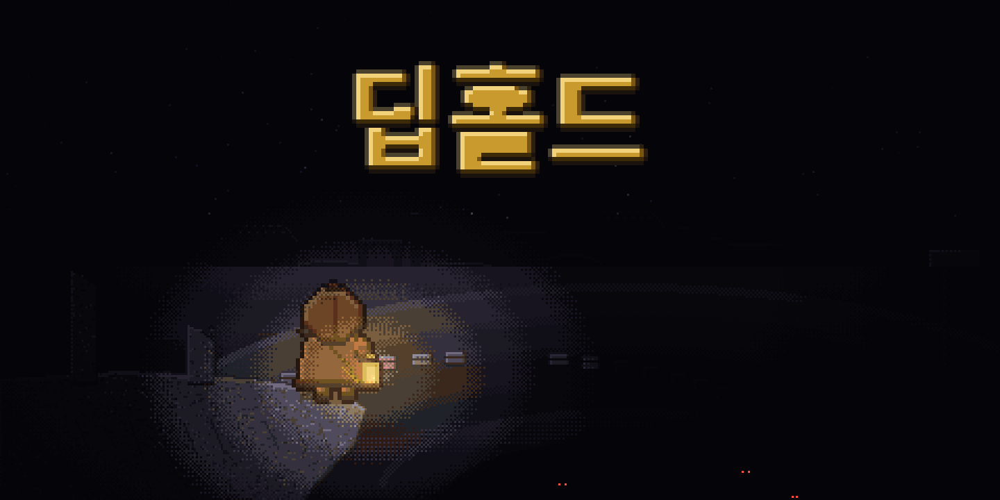

### 랜턴 하나 들고, 끝없이 깊어지는 던전으로.

**던전을 파밍하고 · 내 던전을 짓고 · 친구가 도전하는 2.5D 도트 액션**

**[⬇ 다운로드](https://github.com/starMinK/deephold-releases/releases/latest)** &nbsp;·&nbsp; **[패치 노트](패치노트/README.md)** &nbsp;·&nbsp; **[확률 정보](docs/확률정보.md)** &nbsp;·&nbsp; **[개인정보 처리방침](docs/개인정보처리방침.md)** &nbsp;·&nbsp; **[의견 남기기](https://github.com/starMinK/deephold-releases/issues)**

---

> **🆕 v0.5.2 — 용광로 손질** &nbsp;→&nbsp; [패치 노트](패치노트/v0.5.2.md) &nbsp;·&nbsp; 더 빠르고 짧고 공정해진 멈추지 않는 용광로, 커진 고유 엠블럼

## 🕯 어떤 게임인가요

딥홀드는 **한 번 들어가면 욕심이 나는** 던전 탐험 게임입니다.

층을 내려갈수록 몬스터는 많아지고 빨라지지만, 보상도 그만큼 커집니다. 지금 돌아갈지, 한 층만 더 내려갈지는 언제나 당신의 선택. 랜턴 기름이 떨어지기 전에, 그리고 체력이 바닥나기 전에요.

모아 온 자원으로는 **나만의 던전**을 짓습니다. 함정을 깔고, 소환한 몬스터를 배치하고, 친구에게 도전장을 보내세요. 누가 더 깊이 내려가고, 누구의 던전이 더 악랄한지 겨뤄 봅시다.

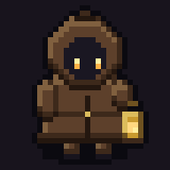

## ⚔ 특징

| | |
| --- | --- |
| 🗺 **매번 다른 던전** | 층마다 지도, 몬스터 편성, 층 성격(함정 · 사냥꾼 · 보물 창고 · 혼불 제단…)이 무작위로 바뀝니다. |
| 🔥 **랜턴과 어둠** | 시야는 랜턴 불빛이 닿는 곳까지. 기름은 폐광산에서 역청을 캐서 직접 만듭니다. |
| 💀 **아주 어려운 실시간 액션** | 예고 동작을 읽고 구르고 피하세요. 깊어질수록 적의 공격은 빨라집니다. |
| 🏰 **내 던전 꾸미기** | 지형 · 장치 · 함정을 배치하고, 소환한 몬스터로 친구를 맞이하세요. |
| 👻 **몬스터 소환** | 혼불로 50종의 몬스터를 소환합니다. 모든 확률은 [공개](docs/확률정보.md)되어 있습니다. |
| 🏘 **함께하는 마을** | 광장에서 친구를 만나 채팅하고, 상점 · 정제소 · 폐광산을 오가며 원정을 준비하세요. |

## 🌑 다섯 개의 깊이

<table>
<tr>
<td align="center" width="50%">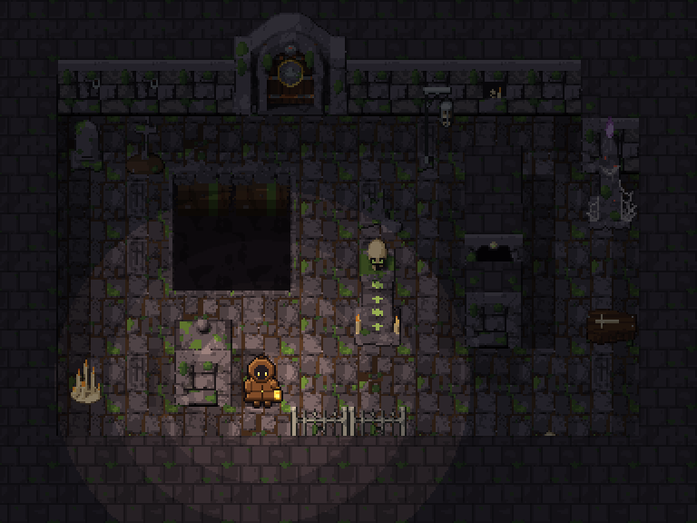 <b>이끼 묘지</b> · 1~3층</td>
<td align="center" width="50%">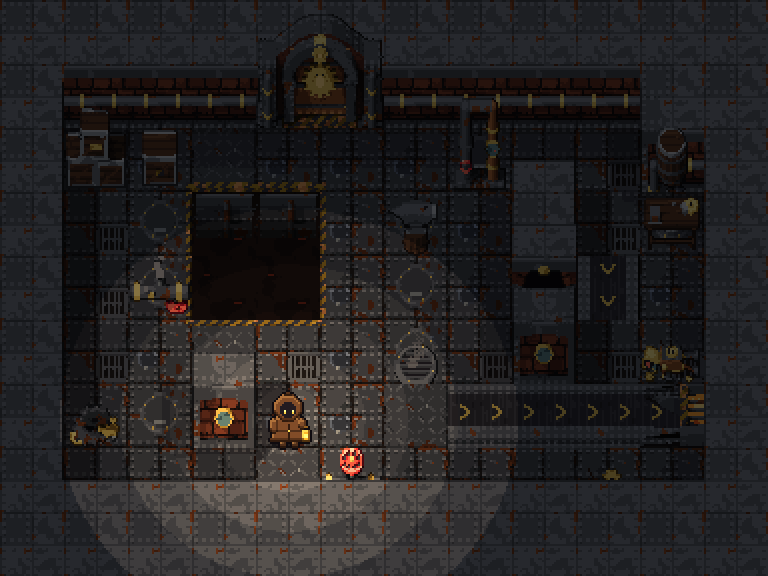 <b>녹슨 공방</b> · 4~6층</td>
</tr>
<tr>
<td align="center">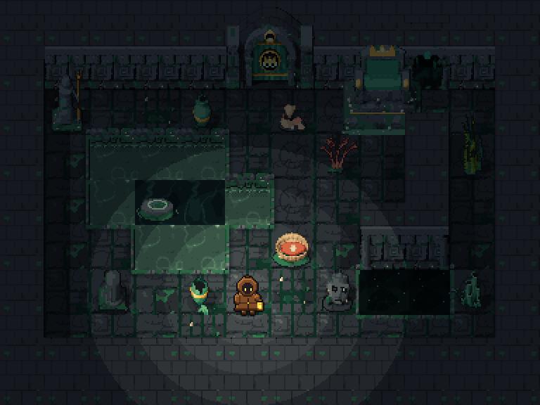 <b>가라앉은 신전</b> · 7~9층</td>
<td align="center">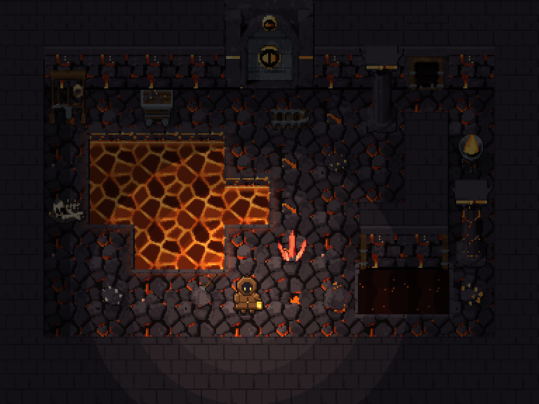 <b>용암 광맥</b> · 10~12층</td>
</tr>
<tr>
<td align="center" colspan="2">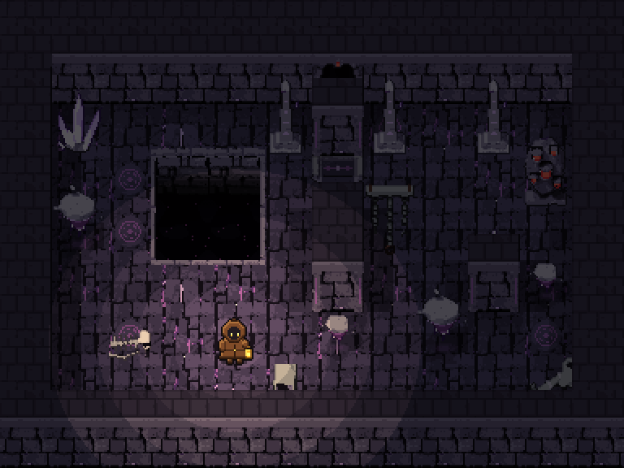 <b>칠흑 심연</b> · 13층부터 끝없이</td>
</tr>
</table>

## 👑 깊은 곳의 주인들

<table>
<tr>
<td align="center">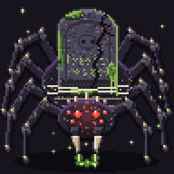 <b>무덤지기 거미왕</b> 이끼 묘지</td>
<td align="center">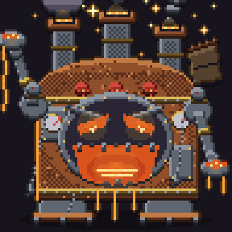 <b>멈추지 않는 용광로</b> 녹슨 공방</td>
<td align="center">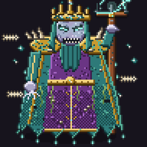 <b>익사한 왕</b> 가라앉은 신전</td>
</tr>
<tr>
<td align="center">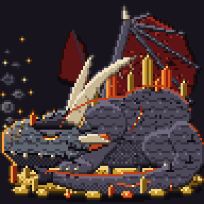 <b>잠든 화룡</b> 용암 광맥</td>
<td align="center">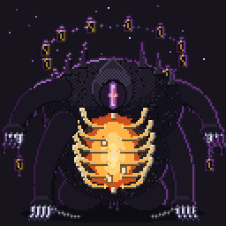 <b>랜턴을 삼킨 자</b> 칠흑 심연</td>
<td align="center"> <b>???</b> 더 깊은 곳에…</td>
</tr>
</table>

## 🏘 마을

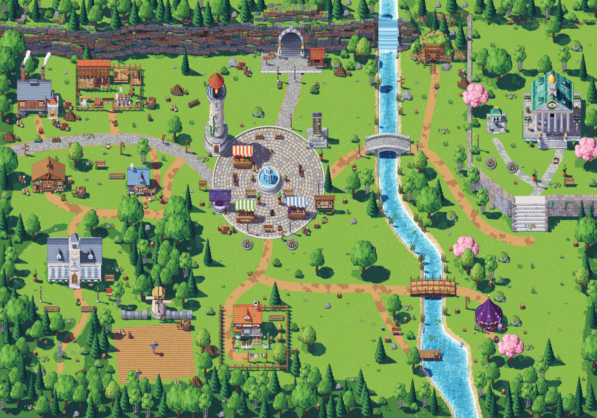

원정에서 돌아오면 마을에서 쉬어 가세요. 광장의 친구들, 은전을 받는 상점, 이끼석을 기름으로 바꾸는 정제소, 그리고 마을 뒤편의 폐광산이 기다립니다.

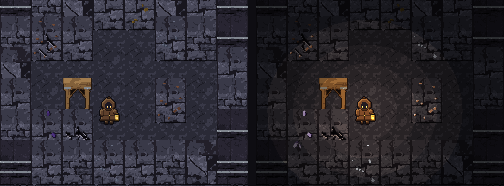
 폐광산 — 위 갱도에서는 역청을, 깊은 갱도에서는 철 · 은 · 금 · 심연 수정을 캡니다.

## ⬇ 설치 방법

1. **[최신 버전 페이지](https://github.com/starMinK/deephold-releases/releases/latest)** 에서 `Deephold-Setup-버전.exe` 를 받아 실행합니다.
2. 파란 **"Windows의 PC 보호"** 창이 뜨면 **추가 정보 → 실행** 을 누르세요. 아직 정식 서명이 없어서 나오는 안내입니다.
3. 설치 후에는 게임을 켤 때마다 새 버전을 **자동으로** 받습니다.

<b>Edge에서 "일반적으로 다운로드되지 않습니다" 경고가 뜨면</b>

1. 오른쪽 위 다운로드 목록에서 파일 옆 **⋯** 를 누르고 **유지** 를 고릅니다.
2. 확인 창이 뜨면 아래쪽 **자세히 표시 ▾** 를 눌러 **그래도 계속** 을 누릅니다.
3. **그래도 계속** 이 안 보이면 회사·학교 PC처럼 SmartScreen 설정이 잠긴 경우예요. **Chrome** 같은 다른 브라우저로 받거나, `Deephold-버전-portable.exe` 를 받아 보세요.

> 설치 없이 해 보고 싶다면 `Deephold-버전-portable.exe` 를 받으세요. 포터블은 자동 업데이트가 되지 않습니다.
>
> **v0.2.3 이하를 쓰고 있다면** 위 페이지에서 한 번만 새로 설치해 주세요. 그다음부터는 자동으로 업데이트됩니다.

| 항목 | 내용 |
| --- | --- |
| 운영체제 | Windows 10 / 11 (64비트) |
| 인터넷 | 마을 광장 · 친구 던전 · 랭킹에 필요 |

## 💬 의견 남기기

버그를 찾았거나 이런 게 있으면 좋겠다 싶으면 **[Issues](https://github.com/starMinK/deephold-releases/issues)** 에 남겨 주세요. 모든 의견을 읽습니다.

## © 저작권

게임의 코드와 에셋(그림 · 소리 · 음악 등)은 무단으로 복제, 수정, 재배포하거나 다른 용도로 사용할 수 없습니다. 플레이 영상과 스크린샷은 자유롭게 올려도 됩니다. 자세한 내용은 [LICENSE](LICENSE) 를 확인하세요.

Made by <b>Qmin Lab</b>

