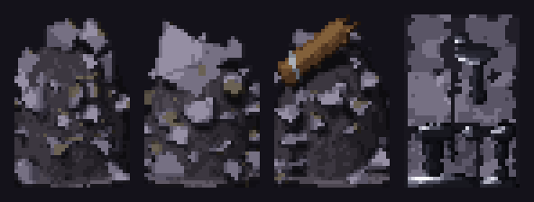

# 딥홀드 v0.3.0 — 깊은 곳의 문이 열린다

**보스층 · 파티 · 제련소 · 1080 화면**

> [!IMPORTANT]
> **이번 버전은 한 번 새로 설치해야 해요.** 다운로드 위치가 바뀌었어요.
> 👉 **[여기서 받기](https://github.com/starMinK/deephold-releases/releases/latest)** — `Deephold-Setup-0.3.0.exe` 를 받아 설치하면, 그다음부터는 다시 자동으로 업데이트돼요.
>
> 이제 딥홀드는 **인터넷에 연결되어 있어야** 켤 수 있어요.

---

## 한눈에 보기

| | |
| --- | --- |
| 👑 **보스층** | 바이옴마다 4층째가 보스층. 3층을 깨면 보스방 문 앞에서 "나갈지 · 들어갈지"를 고른다 |
| 💀 **죽어도 전부 잃지 않음** | 깊이 갈수록 남기는 몫이 커진다. 이끼석 보험으로 더 지킬 수 있다 |
| 🧑‍🤝‍🧑 **파티** | 친구와 최대 4명. 같이 폐광산, 같이 던전 |
| 🔥 **제련소** | 광석 3개 + 역청 1개 = 주괴. 기름은 20분마다 자동 충전 |
| ⛏ **폐광산 대개편** | 광석 3배, 역청 3배, 구르기·달리기, 앞뒤로 캐기, 광석마다 다른 소리 |
| 🖥 **1080 화면** | 더 또렷한 글자, 음악·효과음 따로 조절, 글자·채팅 크기 설정 |

---

## 👑 원정 규칙

### 보스층
- 바이옴 하나 = **4개 층**(보통 3층 + 보스층 1). 4 · 8 · 12층…이 보스층이에요.
- 3층을 깨면 **나가기 / 보스방 들어가기**를 고르는 창이 떠요. 보스방 문을 지나면 바로 4층(보스층)이에요.
- 탈출 포털은 3의 배수 층(3 · 6 · 9…)에 있어요.
- 보스에게 졌을 때 **보스 체력을 몇 % 깎았는지** 보여 줘요. 같은 층 기록끼리는 이 값으로 순위가 갈려요.

### 죽어도 일부는 남긴다
원정에서 죽으면 들고 있던 것 중 일부만 잃어요. 깊이 내려갈수록 남기는 몫이 커져요.

| 죽은 층 | 1층 | 4층 | 10층 | 20층 이후 |
| --- | --- | --- | --- | --- |
| 잃는 몫 | 99% | 90% | 75% | 50% |

정산 화면에 **남긴 것과 잃은 것**이 나란히 나와요.

### 던전 입구에서 준비하기

- **이끼석 보험**: 이끼석 25개를 내면 죽을 때 잃는 몫이 20%p 줄어요.
- **출발 아이템** (각 이끼석 10개, 원정마다 종류별 1개): 랜턴 시야 넓히기 · 시작 유물 고르기 · 회복약
- **연습 모드**: 기름 · 이끼석 없이 들어가요. 1층이나 이미 가 본 바이옴의 첫 층(5 · 9 · 13 · 17층)에서 시작할 수 있어요. 대신 기록 · 랭킹 · 업적 · 아이템이 하나도 남지 않아요. 마음껏 연습하세요.
- **회복약**은 이제 개수 제한 없이 들고 다닐 수 있어요.

### 랭킹 시즌 2
규칙이 크게 바뀌어서 **랭킹이 새로 시작**해요.

---

## 🧑‍🤝‍🧑 파티와 친구

- **파티**: 친구를 초대해 **최대 4명**까지. 폐광산과 던전 입구에 파티 버튼이 생겼어요.
- **같이 폐광산**: 인원이 많을수록 갱도가 넓어지고 광맥도 그만큼 많아져요. 어둠 속에서 친구의 랜턴 불빛이 보여요.
- **같이 던전**: 함께 내려가고, 보스를 잡으면 **기여도 결과**가 나와요.
- **친구 코드**: 기록비 › 친구 탭에서 친구 코드나 닉네임으로 친구 요청을 보낼 수 있어요. 요청이 오면 마을에서 알려 줘요.

---

## 🔥 경제

- **제련소** (예전 정제소): 광석 3개 + 역청 1개 → **철괴 · 은괴 · 금괴**
- **랜턴 기름 자동 충전**: 기름이 2병보다 적으면 **20분마다 1병**씩 차요 (2병까지).
- **판매가 조정** (은전)

| 물건 | 판매가 |
| --- | --- |
| 철광석 | 판매 불가 → 제련소에서 철괴로 |
| 은광석 · 금광석 · 심연 수정 | 1 · 4 · 13 |
| 철괴 · 은괴 · 금괴 | 1 · 4 · 12 |
| 이끼석 · 돌 조각 | 판매 불가 |

- **거래소 일괄 판매**: 여러 개를 한 번에 골라 팔고, 팔기 전에 한 번 더 확인해요.
- **곡괭이 강화**: 건설 작업장에서 이끼석으로 강화, 캐는 시간 최대 −20%.
- **염색**: 재봉사에서 후드 · 랜턴 색을 바꿀 수 있어요 (이끼석 15개).

---

## ⛏ 폐광산

- **광석 3배**: 큰 광맥 몇 개 대신 작은 광맥이 곳곳에 흩어져 있어요.
- **역청 3배**: 위 갱도뿐 아니라 깊은 갱도에서도 나와요.
- **돌 조각**이 훨씬 자주 나와요.
- **구르기 · 달리기**가 폐광산에서도 돼요.
- 키를 누르고 있으면 **계속 휘둘러요**. 위 · 아래 블록은 **앞모습 · 뒷모습으로** 캐요.
- 철 "텅", 은 "팅", 금 "텅-응", 수정 "칭", 역청 "찍" — **광석마다 소리가 달라요**.
- 천장이 무너진 곳은 **돌무더기**로 막혀요 (캐서 뚫을 수 있어요).
- 역청이 무지개 얼룩 대신 **검고 번들거리는 모습**으로 바뀌었어요.
- 같은 박자로 기계처럼 반복해서 캐면(매크로) 아무것도 나오지 않고 **경고가 떠요**.

정확한 확률은 **[확률 정보](../docs/확률정보.md)** 에 공개돼 있어요.

---

## ⚔ 전투

- **보스 반격 틈**: 보스 공격이 끝나면 반드시 숨 고를 틈이 생겨요 (1페이즈 약 1초). "피하기만 하다 끝나는" 일이 없어졌어요.
- **녹슨 공방 자석 골렘**: 여러 마리가 한곳에 몰리지 않고, 동시에 끄는 힘은 2마리까지만.
- **녹슨 포탑**이 쏘는 방향(위 · 아래 · 옆)에 맞는 모습으로 보여요.
- **벽과 바닥**이 다섯 바이옴 모두에서 한눈에 구별돼요.
- 구르기 먼지와 발자국이 움직이는 방향을 따라가요.
- 새끼 거미가 죽을 때 갑자기 커지던 문제를 고쳤어요.

---

## 🖥 화면 · 편의

- **1920×1080** 화면에 맞춰 글자가 더 또렷하고 덜 가려요.
- **설정**: 배경음악 · 효과음 볼륨을 따로 조절, 글자 크기 · 채팅 창 크기 선택.
- **대화창**을 클릭 · Space · Esc 로 바로 닫을 수 있어요.
- 꾸미기(후드 · 랜턴 · 구르기 흔적 · 발자국)가 **마을과 폐광산**에서도 보여요.
- 글자가 창 밖으로 넘치던 곳들을 정리했어요.

---

## 📊 수치 변경 (v0.2.4 → v0.3.0)

바뀐 확률과 가격을 한곳에 모았어요. 몬스터 드롭 · 상자 · 층 성격 · 소환(가챠) 확률은 **그대로**예요. 전체 확률표는 [확률 정보](../docs/확률정보.md)에 있어요.

### 원정

| 항목 | v0.2.4 | v0.3.0 |
| --- | --- | --- |
| 바이옴 길이 | 3층 | **4층** (보통 3 + 보스 1) |
| 칠흑 심연 시작 · 텅 빈 층이 사라지는 층 | 13층 | **17층** |
| 죽었을 때 잃는 것 | 들고 있던 것 **전부** | 1층 99% → 4층 90% → 10층 75% → **20층부터 50%** |
| 이끼석 보험 | 없음 | 이끼석 25개 → 잃는 몫 **−20%p** |
| 출발 아이템 | 없음 | 각 이끼석 10개 (랜턴 시야 +1칸 · 시작 유물 · 첫 층 회복약) |
| 회복약 소지 | 최대 1개 | **제한 없음** |
| 회복약이 나오는 곳 | 상자 4% · 층 클리어 3.5% | 층 시작 지점 **10%** · 상자 3.5% · 몬스터 처치 **0.3%** |
| 유물 재굴림 | 이끼석 10개 | 원정 안에서 n번째 = 10 + 5×(n−1)개 |
| 랭킹 | 시즌 1 | **시즌 2 새로 시작** · 같은 층이면 보스 체력을 많이 깎은 순 |

### 랜턴 기름

| 항목 | v0.2.4 | v0.3.0 |
| --- | --- | --- |
| 자동 충전 | 없음 | 2병보다 적으면 **20분마다 1병** (2병까지) |
| 역청 → 기름 | 3개 = 1병 | 3개 = 1병 (그대로) |
| 이끼석 → 기름 (정제소) | 25개 = 1병 | **없어짐** → 정제소가 제련소로 바뀜 |

### 폐광산

| 항목 | v0.2.4 | v0.3.0 |
| --- | --- | --- |
| 역청 블록 (지도당 평균) | 약 9개 (광맥 2개 × 3~6) | **약 27개 (3배)** · 깊은 갱도에서도 나옴 |
| 광석 블록 (지도당 평균) | 약 18개 (광맥 9개 × 1~3) | **약 54개 (3배)** · 곳곳에 흩어짐 |
| 광석 종류 비율 (철 · 은 · 금 · 수정) | 70 · 22 · 7 · 1% | 그대로 |
| 돌 조각 (평범한 돌을 캘 때) | 1.2% | **13.5%** |
| 곡괭이 강화 | 없음 | 5단계, 캐는 시간 최대 **−20%** (이끼석 20 · 45 · 90 · 160 · 260) |

### 판매가 (은전)

| 물건 | v0.2.4 | v0.3.0 |
| --- | --- | --- |
| 이끼석 | 1 | **판매 불가** (곡괭이 강화 · 내 던전 확장 · 염색에 사용) |
| 돌 조각 | 1 | **판매 불가** (내 던전 지형 블록에 사용) |
| 철광석 | 1 | **판매 불가** (제련소에서 철괴로) |
| 은광석 | 4 | **1** |
| 금광석 | 12 | **4** |
| 심연 수정 | 40 | **13** |
| 철괴 · 은괴 · 금괴 | – | **1 · 4 · 12** (새로 생김) |

광석 한 개 값은 내려갔지만 광석이 3배 나오고, 3개를 제련하면 예전 광석 1개 값이 돼요. 제련할 때 역청이 1개씩 들어요.

### 내 던전

| 항목 | v0.2.4 | v0.3.0 |
| --- | --- | --- |
| 층 추가 비용 | 바이옴 재료만 | 바이옴 재료 + **이끼석 30 · 60 · 100 · 150** |
| 지형 블록 | 무료 | **돌 조각** (벽 1 · 기둥 2 · 그 밖 1, 가장자리 벽은 무료) |
| 염색 | 없음 | 이끼석 15개 (원래 색은 무료) |

---

버그나 의견은 **[Issues](https://github.com/starMinK/deephold-releases/issues)** 에 남겨 주세요.

[← 패치 노트 목록](README.md)

