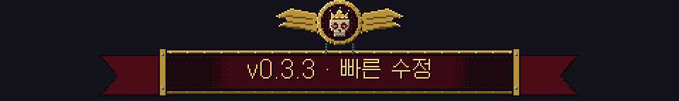
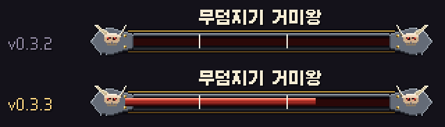
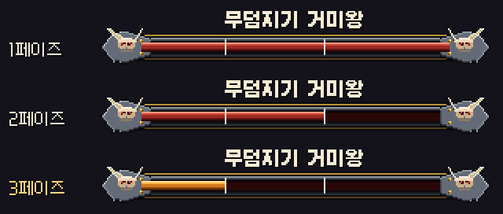
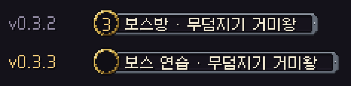

# 딥홀드 v0.3.3 — 빠른 수정

**보스 체력 막대가 드디어 보여요 · 보스 연습장 손보기**

> [!NOTE]
> 설치형은 게임을 켜면 **자동으로 업데이트**돼요.

---

## 👑 보스 체력 막대가 보여요

v0.3.2에서 고쳤다고 했던 보스 체력 막대가 **여전히 비어 보이던 문제**를 이번에 제대로 고쳤어요. 채움이 막대 틀 **뒤에** 그려져서 틀에 가려지고 있었어요. 이제 원정 보스층 · 보스 연습장 · 혼자 · 파티 모두에서 체력이 줄어드는 게 보여요. 죄송해요!

## 🗿 보스 연습장 (기억의 비석)

### 시작 페이즈 고르기

- 보스를 고를 때 **1 · 2 · 3페이즈** 중 하나를 고를 수 있어요. 고른 페이즈가 시작되는 체력으로 바로 시작해요.
- 3페이즈만 연습하고 싶을 때 처음부터 깎을 필요가 없어요.
- 연습이라 기록 · 랭킹 · 업적에는 들어가지 않아요.

### 위쪽 표시판

- 연습장에서 표시판에 **층 번호(3)** 가 뜨던 문제를 고쳤어요. 이제 **"보스 연습 · 보스 이름"** 으로 보여요. 다섯 보스 모두요.

---

확률 · 수치는 **[확률 정보](../docs/확률정보.md)** 에 모두 공개돼 있어요 (이번엔 바뀐 수치 없음). 버그나 의견은 **[Issues](https://github.com/starMinK/deephold-releases/issues)** 에 남겨 주세요.

[← 패치 노트 목록](README.md) · [v0.3.2 패치 노트](v0.3.2.md)

