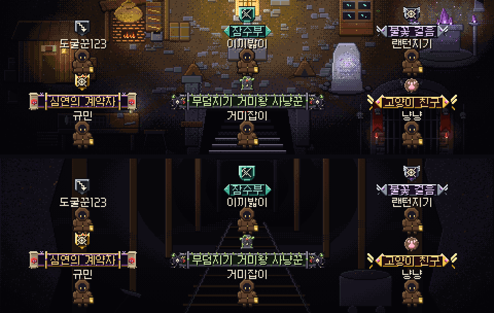
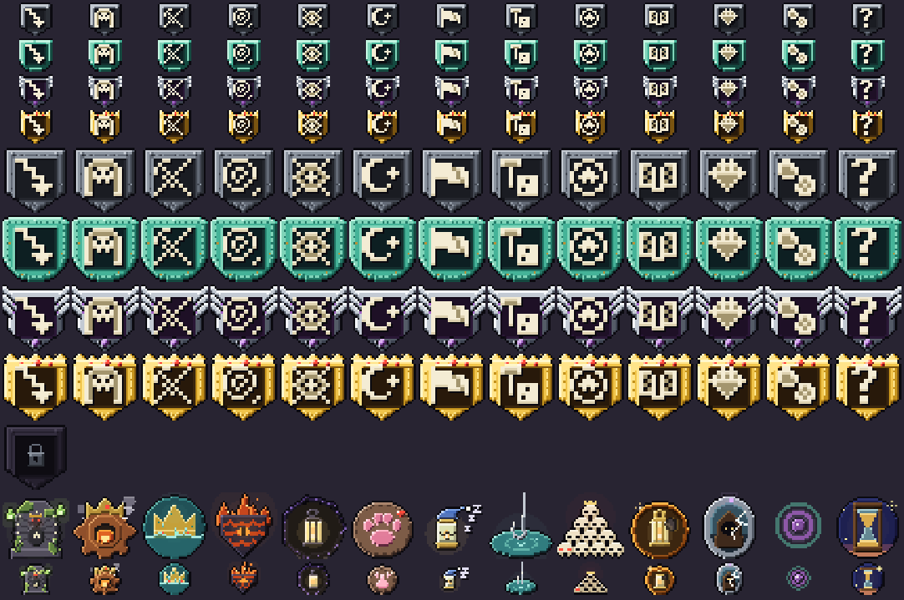
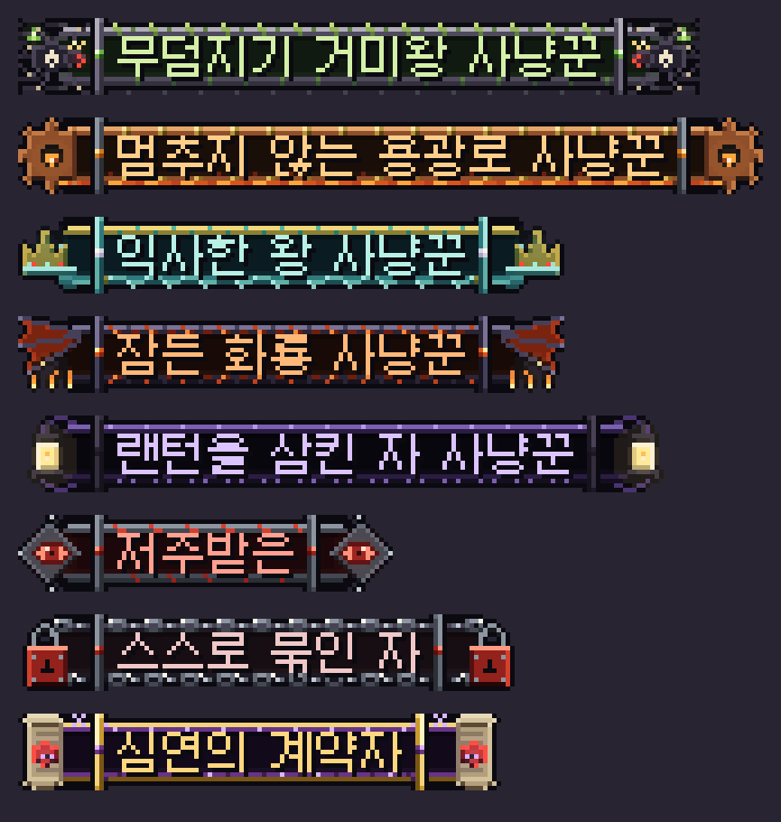
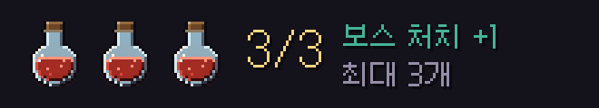
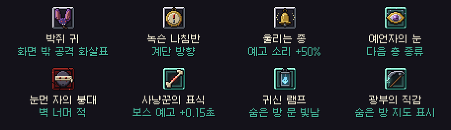
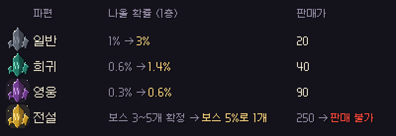

# 딥홀드 v0.4.0 — 엠블럼 · 숨은 방 · 파티 지도

**업적을 머리 위에 달고, 벽 뒤의 비밀을 찾고, 동료와 지도를 나눠요**

> [!NOTE]
> 설치형은 게임을 켜면 **자동으로 업데이트**돼요.

> [!IMPORTANT]
> **파편 확률 · 전설 파편 · 재료 판매가 · 회복약 규칙이 바뀌었어요.** 아래 [📊 수치 변경](#-수치-변경-v033--v040)을 꼭 확인해 주세요. 지금까지 모은 아이템과 기록은 그대로예요.

---

## 🏅 업적 엠블럼 · 칭호

업적을 깨면 **엠블럼**(머리 위 문장)과 **칭호**(이름 위 글귀)를 얻어요. 고른 것은 **마을 · 광장 · 폐광산 · 파티 던전에서 다른 사람에게도 보여요.**

- **기록비 › 엠블럼 · 칭호** 탭에서 얻은 것을 달거나 뗄 수 있어요. 못 얻은 것은 자물쇠와 함께 얻는 조건이 보여요.
- 머리 위는 아래부터 **캐릭터 → 이름 → 칭호 → 엠블럼** 순서로 쌓여요.
- 혼자 원정 중에는 화면을 가리지 않게 엠블럼이 숨겨져요. 설정 **"원정 엠블럼"** 으로 켤 수 있어요.

### 어려운 업적일수록 화려하게

- 업적 난이도에 따라 판이 **철 → 청동 → 은 → 황금** 으로 화려해지고, 가운데에는 업적 분류 문양 13종이 들어가요.
- **보스 정복 5개와 숨은 업적 8개** 는 전용 엠블럼이에요. 거미왕의 묘비, 고양이 발바닥, 해골 탑…

- 칭호 판도 등급별로 달라요. **보스 사냥꾼 5개 · 저주받은 · 스스로 묶인 자 · 심연의 계약자** 는 전용 판이 따로 있어요.
- 엠블럼을 달 때, 새로 얻을 때 소리가 나요.

---

## 🚪 숨은 방

- 보스층을 뺀 원정 층의 **30%** 에 숨은 방이 하나 생겨요.
- 수상한 벽을 그 방향으로 **1초쯤 계속 밀면** 벽이 열려요. 벽에는 아무 표시도 없어요.
- 안에는 **보물상자 1개 + 혼불 1개 + 재료 2~3개** 가 있어요.
- 숨은 방에는 계단 · 포탈 · 층 목표가 없어요. 못 찾아도 층은 깰 수 있어요.
- 유물 **광부의 직감** 이 있으면 지도에 숨은 방이 **보라색** 으로 보여요. **귀신 램프** 가 있으면 숨은 방 문이 희미하게 빛나요.

## 🗺 던전 모양이 달라졌어요

- 맵을 꽉 채우지 않고 **약 20%를 돌 덩어리로 남겨서**, 층 모양이 더 불규칙해졌어요. 방 개수 · 몬스터 수 · 층 목표는 그대로예요.
- **기름 샘 층** 은 기름을 받아야, **보물 창고 층** 은 상자를 모두 열어야 계단이 열려요. 이제 모든 층은 목표를 해야 내려갈 수 있어요 (텅 빈 층만 예외).
- 잠긴 계단 문이 보스문처럼 보이던 문제를 고쳤어요. 지금은 자물쇠 표시를 단 임시 그림이고, 전용 그림은 다음 업데이트에 들어가요.

## 👥 파티 던전

- **지도 공유:** 미니맵과 Tab 지도에 **동료 위치** 가 번호별 색 점으로 보이고, **동료가 밝힌 곳도 내 지도에 같이 기록돼요.**
- **렉 줄이기:** 동료 랜턴 빛을 그리는 부담을 크게 줄였어요 (빛줄기 120 → 40개, 안 움직이면 지난 결과 재사용).
- 보스를 같이 잡으면 **전설 파편 · 회복약은 사람마다 따로** 받아요.

## 👑 보스

- **보스를 깨면 바로 다음 층으로** 가요. 4층 필드로 돌아와 계단을 다시 찾던 문제를 고쳤어요. 탈출 포탈이 있는 층이면 나갈지 · 내려갈지 고르는 창이 떠요.
- **보스방 카메라:** 보스와 멀리 떨어져도 내 캐릭터 주변이 항상 보여요. 보스가 화면 밖에 있으면 **화면 끝에 보스 방향 화살표**, 화면 밖에서 공격이 오면 **그쪽 끝이 붉게 깜빡여요.**
- **보스를 잡으면 회복약 1개 확정!** 대신 회복약은 **최대 3개** 까지 들 수 있어요.

- 3개를 들고 있으면 바닥의 회복약은 그 자리에 남아요. 하나 마시고 돌아와서 주울 수 있어요.

## 🔮 유물 정리

설명만 있고 실제로는 아무 일도 안 하던 유물들이 이제 **진짜로 작동해요.**

- **새로 작동:** 박쥐 귀 · 녹슨 나침반 · 울리는 종 · 예언자의 눈 · 눈먼 자의 붕대
- **효과 바뀜:** 사냥꾼의 표식 → 보스 공격 예고 +0.15초 · 귀신 램프 → 숨은 방 문이 빛남 · 광부의 직감 → 숨은 방 지도 표시
- **설명만 고침:** 꺼져가는 등불 · 촛농 부적("샘 시간 절반") · 메트로놈 조각("공격 속도 +10%")

## 🎬 리플레이

- 리플레이에 **보스 처치** 가 노란 표시로 남고, 보스방 → 다음 층까지 그대로 재생돼요. 최고 기록도 실제 도달한 층으로 집계돼요.
- 리플레이 중 유물 선택 창이 **조작 막대를 가리던 문제** 를 고쳤어요.
- 층 모양이 바뀌었지만 **예전 리플레이는 예전 모양 그대로** 재생돼요.

## ⛏ 폐광산

- 깊은 갱도 광맥이 **17줄 → 36줄** 로 돌아왔어요. 철 · 은 · 금 · 수정 개수는 그대로고, 늘어난 만큼은 **돌 조각 광맥** 이에요 (캐면 돌 조각 1개, 내 던전 블록 재료).
- 폐광산 결과 창에 **"이번에 머문 시간"** 이 보여요.

---

## 📊 수치 변경 (v0.3.3 → v0.4.0)

### 몬스터 파편

| 파편 | 나올 확률 (1층) | 14층 이후 | 판매가 |
| --- | --- | --- | --- |
| 일반 | 1% → **3%** | 약 2.25% → **약 6.8%** | 20 |
| 희귀 | 0.6% → **1.4%** | 약 1.35% → **약 3.2%** | 40 |
| 영웅 | 0.3% → **0.6%** | 약 0.68% → **약 1.35%** | 90 |
| 전설 | 보스 처치 시 3~5개 확정 → **보스 처치 시 5%로 1개** | — | 250 → **판매 불가** |

- 혼불 제단 층은 그대로 ×3이에요.
- 전설 파편은 **보스방 보스에게서만** 나와요. 파티는 사람마다 따로 굴려요. 이미 가진 전설 파편은 그대로예요.

### 던전 재료 판매가 — 절반

| 재료 | v0.3.3 | v0.4.0 |
| --- | --- | --- |
| 뼈 | 2 | **1** |
| 톱니 | 3 | **2** |
| 진주 | 4 | **2** |
| 흑요석 | 6 | **3** |
| 공허석 | 9 | **5** |

- 나오는 양과 블록 제작 · 내 던전 업그레이드 비용은 그대로예요.

### 그 밖에

| 항목 | v0.3.3 | v0.4.0 |
| --- | --- | --- |
| 보스 처치 회복약 | 없음 | **1개 확정** |
| 회복약 소지 | 제한 없음 | **최대 3개** |
| 숨은 방 | 없음 | **층마다 30%** (보스층 제외) |
| 던전 빈 공간 | 없음 | **약 20%** |
| 폐광산 깊은 광맥 | 17줄 | **36줄** (돌 조각 광맥 추가) |

---

## 🗒 플레이 기록 안내

더 나은 밸런스를 위해 **플레이 기록(접속 · 원정 · 폐광산 · 기름 사용)을 90일 동안 저장**해요. 닉네임과 유저 번호만 남고, 채팅은 저장하지 않아요. 설정 화면 맨 아래에도 적혀 있어요.

---

확률 · 수치는 **[확률 정보](../docs/확률정보.md)** 에 모두 공개돼 있어요. 버그나 의견은 **[Issues](https://github.com/starMinK/deephold-releases/issues)** 에 남겨 주세요.

[← 패치 노트 목록](README.md) · [v0.3.3 패치 노트](v0.3.3.md)

