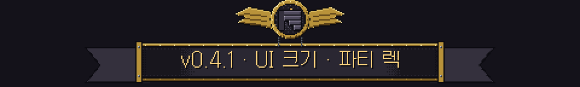
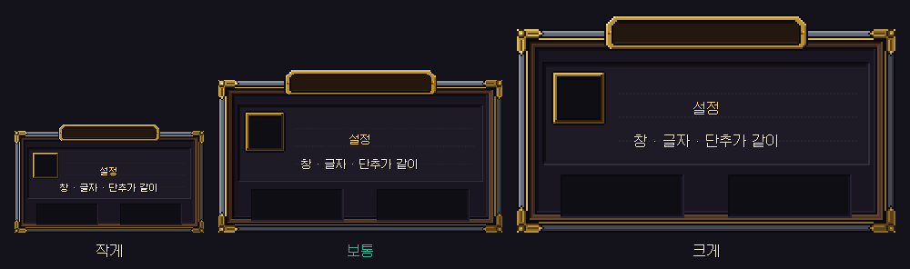
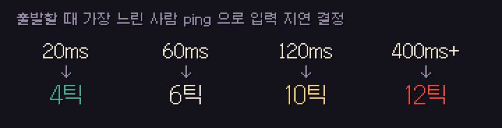
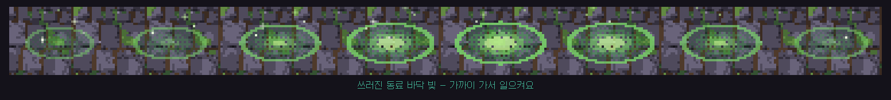
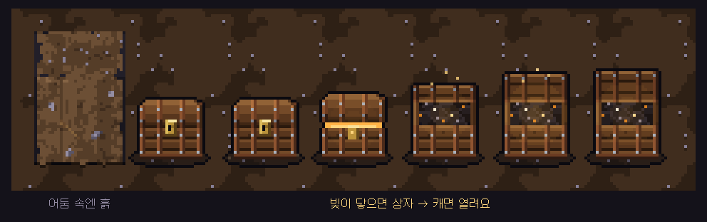
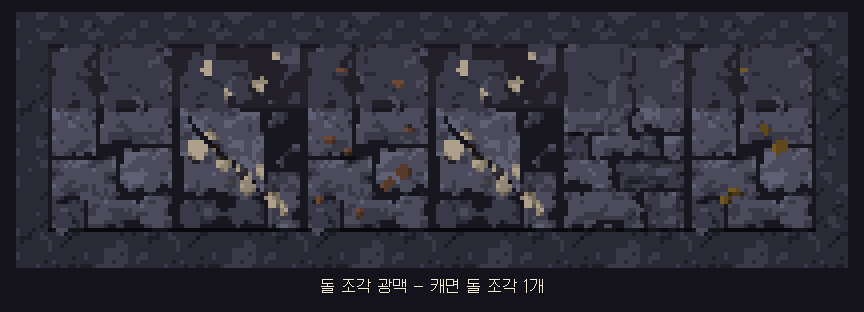
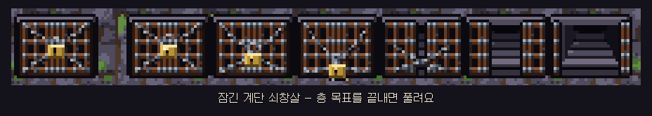
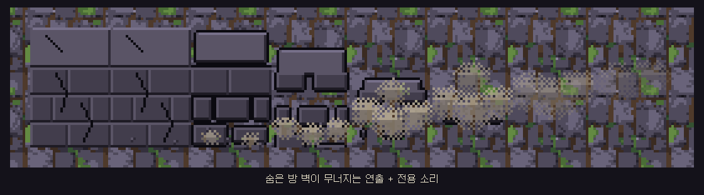
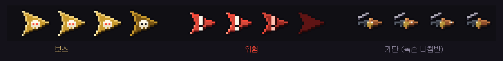

# 딥홀드 v0.4.1 — UI 크기 · 파티 렉 · 새 그림

**창이 한꺼번에 커지고 줄고, 파티가 덜 멈추고, 임시 그림이 진짜 그림이 됐어요**

> [!NOTE]
> 설치형은 게임을 켜면 **자동으로 업데이트**돼요. 확률 · 판매가는 바뀐 게 없어요.

> [!IMPORTANT]
> 설정의 **"글자 크기"가 "UI 크기"로 바뀌었어요.** 업데이트 후 처음에는 모두 **보통** 으로 시작해요. 크게 보고 싶으면 설정에서 다시 골라 주세요.

---

## 🖥 UI 크기

- 예전에는 글자만 커져서 창 안에서 글이 넘치거나 겹쳤어요. 이제 **창 · 글자 · 단추가 같은 비율로 한꺼번에** 커지고 줄어요.
- 마을 창 · 일시정지 · 설정 · 확인 창 · 키 안내 · 원정 가방 · 정산 · 타이틀 · 채팅(말풍선 · 기록 · 입력칸) · 서버 연결 창이 모두 따라요.
- 긴 설명 글은 잘리지 않고 **마우스 휠로 넘겨 볼 수 있어요.**
- 머리 위 **칭호 · 엠블럼도 이름표 크기에 맞춰** 작아졌어요. 칭호가 너무 크던 문제를 고쳤어요.

## 🏅 숨은 업적

- 기록비 › 엠블럼 · 칭호 탭 맨 뒤에 숨은 업적 8개가 **이름 · 조건 "???" 와 어두운 실루엣** 으로 보여요. 얻으면 평소처럼 공개돼요.
- 숨은 업적의 조건이 미리 다 보이던 문제를 고쳤어요.

---

## 👥 파티 렉 줄이기

- 파티장이 출발을 누르면 서버가 모두의 **ping 을 재서, 가장 느린 사람에게 맞춰 입력 지연을 정해요** (4~12틱, 기본 6틱).
- 느린 동료가 있어도 **"○○ 님을 기다리는 중"으로 멈추는 일이 줄어들어요.** 대신 조작이 아주 조금(0.1~0.2초) 늦게 반응할 수 있어요.
- 파티 던전 · 같이 폐광산의 **성능 기록을 10초마다 남겨서** 렉 원인을 계속 찾아 고칠게요.

## 🫂 파티 그 밖에

- 쓰러진 동료 자리에 **초록 바닥 빛** 이 생겨요. 예전의 원 테두리 대신이에요.
- 파티 창에 **파티를 만든 곳에 맞는 출발 단추 하나만** 보여요 (던전 입구에서 만들면 던전, 폐광산에서 만들면 폐광산).

---

## ⛏ 폐광산

- **광부의 상자** 에 전용 그림이 생겼어요. 어둠 속에서는 흙처럼 숨어 있다가 **빛이 닿으면 상자가 보이고, 캐면 열리면서** 사라져요.

- **돌 조각 광맥** 도 전용 그림으로 바꿔서 일반 바위 · 광석과 구분돼요.
- **같이 폐광산(2인 이상)에서 깊이 내려가면 어둠이 사라져 지도가 다 보이던 버그** 를 고쳤어요. 이제 맨 아래까지 어둠이 유지돼요.
- 같이 폐광산 지도 끝의 벽은 어떤 경우에도 캘 수 없게 안전장치를 넣었어요.

## 🗝 던전

- 잠긴 계단이 **쇠창살 그림** 으로 바뀌었어요. 층 목표를 끝내면 자물쇠가 풀리고 창살이 걷혀요.

- 숨은 방 벽을 밀어 열면 **벽이 무너지는 연출과 전용 소리** 가 나요.

- 화면 밖 화살표(**보스 · 위험 · 녹슨 나침반 계단**)가 삼각형에서 전용 그림으로 바뀌었어요.
- 유물 **울리는 종** 에 전용 소리가 생겼어요.

## 🧱 내 던전

- 블록 · 함정을 고르는 칸에 **필요한 수 / 가진 수** 가 보여요. 모자라면 빨간 글자예요 (지형 블록은 돌 조각, 함정은 마력).
- 지우거나 되돌려서 설계 비용이 줄면, 줄어든 **돌 조각을 100% 창고로 돌려받아요.**
  - 공개된 던전이 쓰고 있는 몫, 옛 저장이나 면적 넓히기로 공짜로 받은 몫은 돌려받지 않아요.

---

확률 · 수치는 **[확률 정보](../docs/확률정보.md)** 에 모두 공개돼 있어요. 버그나 의견은 **[Issues](https://github.com/starMinK/deephold-releases/issues)** 에 남겨 주세요.

[← 패치 노트 목록](README.md) · [v0.4.0 패치 노트](v0.4.0.md)

