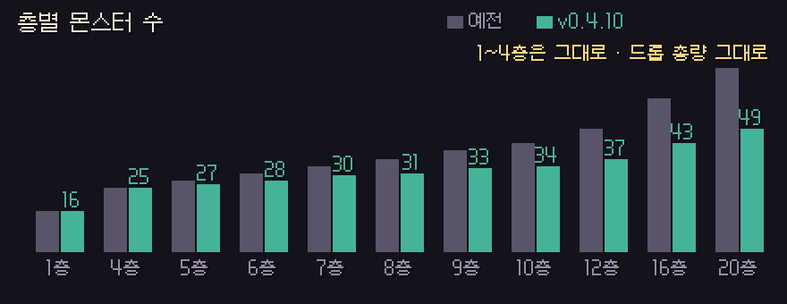

# 딥홀드 v0.4.10 — 몬스터 수 · 유물 · 공지

**깊은 층이 덜 붐비고, 유물이 쓰였는지 보이고, 공지·점검이 게임 안에 떠요**

> [!NOTE]
> 설치형은 게임을 켜면 **자동으로 업데이트**돼요. 파티 · 같이 폐광산은 모두 **v0.4.10** 이어야 해요.

---

## 👹 층별 몬스터 수

- **1~4층은 그대로**예요. **5층부터** 층마다 늘어나는 수가 3마리에서 **1.5마리**로 줄었어요.
- 7층 34 → **30**, 8층 37 → **31**, 12층 49 → **37**, 20층 73 → **49**마리예요.
- 몬스터가 줄어도 **한 층에서 나오는 드롭 총량은 그대로**예요. 남은 몬스터가 조금 더 잘 떨어뜨려요.
- 보스는 바뀌지 않았어요.

## ✨ 유물 발동 표시

- 유물이 발동하면 캐릭터 위로 **그 유물 아이콘이 솟아오르고**, 짧은 소리가 나고, **HUD 유물 칸이 번쩍**여요.
- 대상 유물: 깨진 방패 조각 · 망자의 시계 · 거꾸로 선 모래시계 · 금 간 거울 · 반사 비늘 · 잔불 신발 · 그을린 끈 · 탐욕의 주머니

## 🎯 투사체 유물

- 모든 몬스터 · 보스 공격을 **투사체 / 근접 / 장판 · 범위 / 돌진** 으로 나눴어요.
- **금 간 거울 · 반사 비늘** 은 이제 **투사체에만** 적용돼요. 어떤 공격엔 되고 어떤 공격엔 안 되던 문제를 고쳤어요. 돌진하는 꼭두각시를 베어도 효과는 없어요.

## 🌱 쉬운 모드 보스

- 쉬운 모드 보스(와 1페이즈만 열린 보스 연습장)의 체력 막대가 **1페이즈 체력만큼** 보여요. 이름 옆에 '· 1페이즈'가 붙어요.

## 🐀 몬스터 판정

- 뼈쥐 · 포자 버섯 · 이끼 슬라임 · 무덤 구더기의 몸 · 공격 판정이 **그림 모양대로** 맞게 바뀌었어요.
- 검은 심연 오벨리스크 · 용암 화로 · 석상 머리 같은 던전 소품도 그림 모양대로 막아요.

## 📢 공지 · 점검 · 오류 보고

- 타이틀과 마을 위에 **공지 띠**가 떠요. X로 닫으면 같은 공지는 다시 안 떠요.
- 서버 점검 중이면 "점검 중이에요 — ~시 ~분까지" 창이 떠요. 원정 중이면 그 판은 끝까지 할 수 있어요.
- 게임에서 오류가 나면 자동으로 보고돼요 (버전 · 화면 · 오류 내용만, 닉네임 말고 개인 정보는 담지 않아요).
- 타이틀 아래에 **지금 버전**이 작게 보여요.

---

## 📊 수치 변경 (v0.4.9 → v0.4.10)

| 항목 | v0.4.9 | v0.4.10 |
| --- | --- | --- |
| 5층부터 층마다 몬스터 | +3마리 | **+1.5마리** |
| 7층 / 12층 / 20층 몬스터 | 34 / 49 / 73 | **30 / 37 / 49** |
| 한 층 드롭 총량 | — | **그대로** |
| 금 간 거울 · 반사 비늘 | 공격마다 들쭉날쭉 | **투사체에만** |

- 예전 리플레이는 **예전 규칙 그대로** 재생돼요.

---

확률 · 수치는 **[확률 정보](../docs/확률정보.md)** 에 모두 공개돼 있어요. 버그나 의견은 **[Issues](https://github.com/starMinK/deephold-releases/issues)** 에 남겨 주세요.

[← 패치 노트 목록](README.md) · [v0.4.9 패치 노트](v0.4.9.md)

