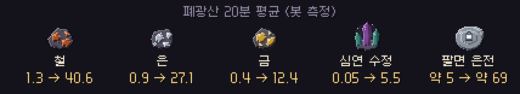
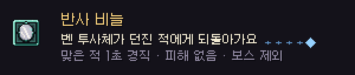
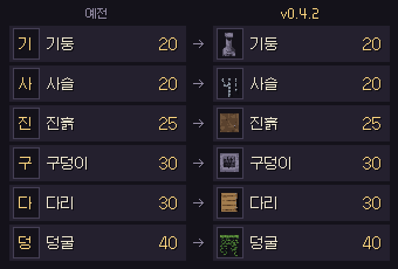

# 딥홀드 v0.4.2 — 광맥 · 반사 · 관전

**폐광산에 광석이 가득하고, 반사 비늘이 진짜로 튕겨내고, 쓰러져도 보고 싶은 동료를 골라 봐요**

> [!NOTE]
> 설치형은 게임을 켜면 **자동으로 업데이트**돼요.

> [!IMPORTANT]
> **폐광산 광석이 약 30배로 늘었어요.** 대신 평범한 돌에서 나오는 돌 조각은 줄었어요. 아래 [📊 수치 변경](#-수치-변경-v041--v042)을 확인해 주세요.

---

## ⛏ 폐광산 광맥 대개편

- 깊은 갱도의 **10%가 광맥** 이에요. 예전에는 약 1%였어요.
- 광맥이 **2~10블록짜리 큰 덩어리** 로 나와요. 하나 찾으면 줄줄이 캐요.
- **심연 수정** 이 나올 확률이 약 3배가 됐어요.
- 20분 동안 캐서 팔면 평균 **약 69 은전** 이에요. 예전에는 약 5 은전이었어요.
- 광맥을 따라 연달아 캘 때 **매크로로 잘못 잡히던 문제** 를 고쳤어요. 일정한 박자로 클릭만 반복하는 자동 입력은 여전히 잡혀요.
- 같이 폐광산에서 **동료의 곡괭이 모션이 한 번만 움직이고 멈추던 문제** 를 고쳤어요.

## 🔮 반사 비늘

- 이제 벤 투사체가 사라지지 않고 **청백색 빛으로 던진 적에게 되돌아가요.** 맞은 적은 1초 동안 굳어요.
- 피해는 없고 내 캐릭터는 맞지 않아요. 보스 · 전설 몬스터는 굳지 않아요.

## 👑 보스 · 던전

- 보스방에 들어간 뒤 **보스가 움직이지 않는 처음 1.5초 동안은 보스도 무적** 이에요. 때리면 튕기는 표시가 나요. 파티 보스도 같아요.
- 떨어진 아이템의 **빛기둥은 랜턴 빛이 닿는 곳에서만 보여요.** 닫힌 숨은 방 안의 아이템은 방을 열기 전까지 안 보여요. 빛기둥 때문에 숨은 방 위치가 들통나던 문제를 고쳤어요.

## 👥 파티 관전

- 파티 던전에서 쓰러지면 **보고 싶은 동료를 골라서 관전** 할 수 있어요. ← / → 키(A / D)나 화면 아래 ◀ ▶ 를 눌러요.
- 화면 아래에 **"관전 중: 닉네임"** 이 뜨고, 미니맵 · 지도에서도 보고 있는 동료가 표시돼요.
- 보던 동료가 쓰러지거나 나가면 다음 동료로 자동으로 넘어가요.

## 🏅 엠블럼 · 칭호

| 장소 | 다른 사람 엠블럼 · 칭호 | 내 엠블럼 · 칭호 |
| --- | --- | --- |
| 마을 · 광장 · 폐광산 | 보여요 | 보여요 |
| 던전 (혼자 · 파티) · 보스 연습장 | **숨겨요** (이름표는 보여요) | 설정 **"원정 엠블럼"** 을 따라요 |

- 폐광산에서 내 엠블럼 · 칭호가 안 보이던 문제를 고쳤어요.
- 못 얻은 업적은 **이름만 보이고 조건은 "???"** 로 가려져요. 얻으면 조건이 보여요.
- 기록비의 머리 위 미리보기에서 **긴 칭호가 칸 밖으로 넘쳐 창 위에 그려지던 문제** 를 고쳤어요.
- 파티에 들어갈 때 내 엠블럼 · 칭호를 다시 알려서, 접속한 뒤 바꾼 엠블럼도 동료에게 보여요.

## 🛒 상점 · 화면

- 상점 구매 탭에 블록 이름의 첫 글자 대신 **실제 블록 그림** 이 보여요.
- 키 설정 창에서 **안내 문구가 마지막 키 줄과 겹치던 문제** 를 고쳤어요.

---

## 📊 수치 변경 (v0.4.1 → v0.4.2)

| 항목 | v0.4.1 | v0.4.2 |
| --- | --- | --- |
| 깊은 갱도 광맥 자리 | 약 1% (36개 × 1~2블록) | **10%** (약 106개 × 2~10블록) |
| 심연 수정 가중치 | 1 | **3** |
| 돌 조각 광맥 (1인 지도) | 약 28개 | **100개까지** |
| 평범한 돌에서 돌 조각 | 3.6% | **1.0%** |
| 20분 평균 철 / 은 / 금 / 수정 | 1.3 / 0.9 / 0.4 / 0.05 | **41 / 27 / 12 / 5.5** |
| 20분 평균 돌 조각 | 약 23 | 약 16 |
| 보스방 입장 직후 보스 무적 | 없음 | **1.5초** |

- 예전 리플레이는 **예전 규칙 그대로** 재생돼요.

---

확률 · 수치는 **[확률 정보](../docs/확률정보.md)** 에 모두 공개돼 있어요. 버그나 의견은 **[Issues](https://github.com/starMinK/deephold-releases/issues)** 에 남겨 주세요.

[← 패치 노트 목록](README.md) · [v0.4.1 패치 노트](v0.4.1.md)

