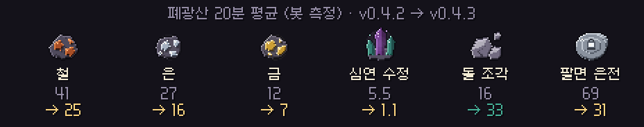

# 딥홀드 v0.4.3 — 폐광산 광맥 조정

**광석은 알맞게, 돌 조각은 넉넉하게**

> [!NOTE]
> 설치형은 게임을 켜면 **자동으로 업데이트**돼요. 폐광산 외에는 바뀐 게 없어요.

---

## ⛏ 폐광산 광맥

v0.4.2에서 광석이 너무 많이 나와서, 광맥을 **예전 방식으로 되돌리고 개수만 크게 늘렸어요.**

- 광맥은 다시 **1~2블록짜리 작은 광맥** 이에요. 대신 **지도마다 200개** 로 곳곳에 흩어져 있어요. v0.4.1에는 36개였어요.
- 광맥 블록 확률도 v0.4.1과 같아요. 돌 조각 52.6% · 철 23.7% · 은 15.5% · 금 7.2% · 심연 수정 1.0%예요.
- 평범한 돌에서 돌 조각이 나올 확률이 **3.6%** 로 돌아왔어요.
- 20분 동안 캐서 팔면 평균 **약 31 은전**, 돌 조각은 **약 33개** 예요. 내 던전을 꾸미기 훨씬 쉬워졌어요.
- 광맥을 따라 캘 때 매크로로 잘못 잡히지 않게 고친 것은 그대로예요.

---

## 📊 수치 변경 (v0.4.2 → v0.4.3)

| 항목 | v0.4.2 | v0.4.3 |
| --- | --- | --- |
| 깊은 갱도 광맥 | 칸의 10% · 2~10블록 덩어리 | **200개 · 1~2블록** |
| 심연 수정 가중치 | 3 | **1** |
| 돌 조각 광맥 상한 | 100개 | **없음** (1인 평균 약 150) |
| 평범한 돌에서 돌 조각 | 1.0% | **3.6%** |
| 1인 지도 광석 블록 | 약 257 | **약 139** |
| 20분 평균 철 / 은 / 금 / 수정 | 41 / 27 / 12 / 5.5 | **25 / 16 / 7 / 1.1** |
| 20분 평균 돌 조각 | 약 16 | **약 33** |
| 20분 평균 은전 (제련 후 판매) | 약 69 | **약 31** |

- 광석을 모두 괴로 만들려면 20분에 역청이 약 15개 필요해요. 기름과 나눠 써야 하니 아껴 써 주세요.

---

확률 · 수치는 **[확률 정보](../docs/확률정보.md)** 에 모두 공개돼 있어요. 버그나 의견은 **[Issues](https://github.com/starMinK/deephold-releases/issues)** 에 남겨 주세요.

[← 패치 노트 목록](README.md) · [v0.4.2 패치 노트](v0.4.2.md)

