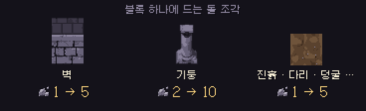

# 딥홀드 v0.4.4 — 내 던전 돌 조각 비용

**폐광산에서 돌 조각이 넉넉해진 만큼, 지형 블록 값을 올렸어요**

> [!NOTE]
> 설치형은 게임을 켜면 **자동으로 업데이트**돼요. **이미 지어 둔 던전은 그대로** 예요. 돌 조각이 새로 빠지지 않아요.

---

## 🧱 지형 블록 돌 조각 비용 5배

| 블록 | v0.4.3 | v0.4.4 |
| --- | --- | --- |
| 벽 | 1 | **5** |
| 기둥 | 2 | **10** |
| 그 밖의 지형 블록 (진흙 · 다리 · 덩굴 · 물 · 용암 …) | 1 | **5** |

- 함정 · 장치는 지금처럼 은전과 마력을 써요.
- v0.4.3부터 폐광산 20분에 돌 조각이 약 33개 나와요. 벽 약 6개 분량이에요.

## ↩ 패치 전에 깔아 둔 블록

- 업데이트 전에 놓은 블록은 **옛 블록** 으로 기억돼요.
- 옛 블록을 지우거나 되돌리면 **예전 값 그대로** 돌려받아요(벽 · 그 밖 1개, 기둥 2개).
- 업데이트 뒤에 새로 놓은 블록은 새 값(5개, 10개)을 내고, 지우면 **100%** 돌려받아요.
- 옛 블록 자리에 다시 놓으면 새 블록이 돼요.

---

확률 · 수치는 **[확률 정보](../docs/확률정보.md)** 에 모두 공개돼 있어요. 버그나 의견은 **[Issues](https://github.com/starMinK/deephold-releases/issues)** 에 남겨 주세요.

[← 패치 노트 목록](README.md) · [v0.4.3 패치 노트](v0.4.3.md)

