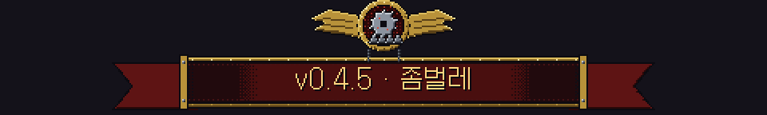
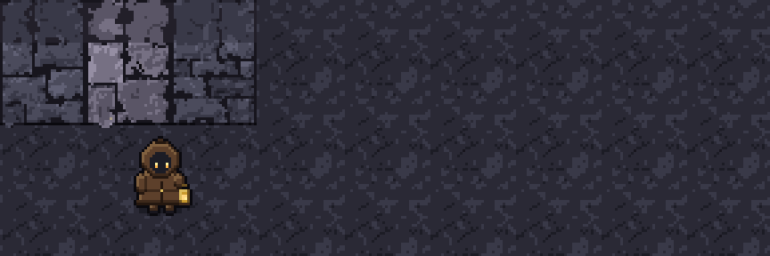
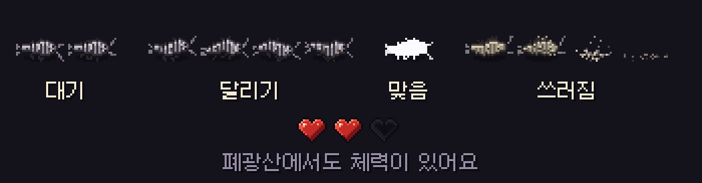

# 딥홀드 v0.4.5 — 좀벌레

**폐광산 돌 속에 무언가 숨어 있어요**

> [!NOTE]
> 설치형은 게임을 켜면 **자동으로 업데이트**돼요. 같이 폐광산은 모두 v0.4.5여야 함께 들어갈 수 있어요.

---

## 🐛 좀벌레

- 폐광산에서 **평범한 돌을 캘 때 3% 확률** 로 돌 속에서 좀벌레가 튀어나와요. 광맥 · 역청 · 광부의 상자에는 없어요.
- 좀벌레가 든 돌은 캐는 동안 **아주 작은 기척** 이 있어요. 흙먼지 한두 점과 작은 긁는 소리예요. 잘 보면 미리 알 수 있어요.
- 돌이 깨지면 캐릭터와 떨어진 쪽에서 나와 **0.3초 멈췄다가 빠르게 달려와요.**
- 곡괭이(J)로 **두 번** 치면 잡혀요. 칠 때마다 뒤로 밀려나요.

## ❤ 폐광산 체력

- 폐광산에서도 **체력(하트 3개)** 이 있어요. 좀벌레에게 물리면 하트가 하나 줄고, 잠깐 무적이 돼요.
- 하트가 모두 없어지면 **마을로 돌아가요.** 이번에 캔 것은 **잃지 않아요.**
- 같이 폐광산에서는 쓰러진 사람만 마을로 가고, 나머지는 계속 캘 수 있어요. 좀벌레는 가장 가까운 사람을 쫓아가요.
- 매크로 판정은 이제 **경고만** 해요. 캔 것을 막지 않아요.

## 📦 광부의 상자

- 광부의 상자 앞에서 **J를 누르면 바로 열려요.** 더 이상 블록처럼 오래 캐지 않아도 돼요.
- 한 번 빛에 드러난 상자는 **계속 상자로 보여요.** 보는 방향에 따라 흙 그림으로 바뀌던 문제를 고쳤어요.

---

## 🛠 고친 것

- **숨은 방:** 열기 전에 방 안이 밝게 보이고 지도에 찍히던 문제를 고쳤어요.
- **마을로 나올 때:** 던전 · 폐광산에서 나오면 캐릭터가 저절로 앞으로 걸어가던 문제를 고쳤어요.
- **마을 강:** 강이 휘는 곳에서 물결이 네모나게 보이던 것을 강 모양에 맞췄어요.
- **같이 폐광산:** 칭호 · 엠블럼이 이름을 가리던 문제를 고쳤어요.
- **프로필 카드:** 캐릭터 그림이 초상 틀 위로 삐져나오던 문제를 고쳤어요.

---

확률 · 수치는 **[확률 정보](../docs/확률정보.md)** 에 모두 공개돼 있어요. 버그나 의견은 **[Issues](https://github.com/starMinK/deephold-releases/issues)** 에 남겨 주세요.

[← 패치 노트 목록](README.md) · [v0.4.4 패치 노트](v0.4.4.md)

