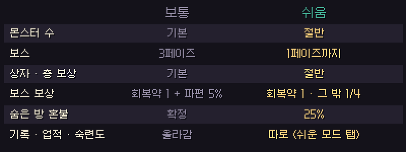
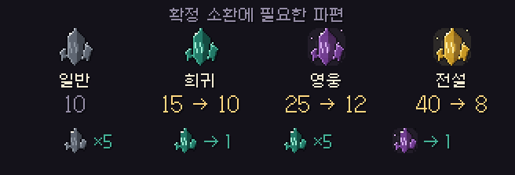
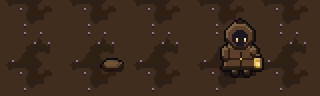
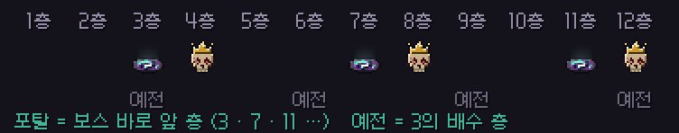

# 딥홀드 v0.4.6 — 쉬운 모드 · 파편 · 몬스터 연습

**어렵다면 쉬움으로, 파편은 덜 극악하게, 좀벌레는 뒤에서**

> [!NOTE]
> 설치형은 게임을 켜면 **자동으로 업데이트**돼요. 파티 · 같이 폐광산은 모두 v0.4.6이어야 함께 들어갈 수 있어요.

> [!IMPORTANT]
> **확정 소환에 필요한 파편이 크게 줄었어요** (희귀 15→10 · 영웅 25→12 · 전설 40→8). 아래 [📊 수치 변경](#-수치-변경-v045--v046)을 확인해 주세요.

---

## 🌱 쉬운 모드

- 던전 입구 출발 창에서 **보통 · 쉬움** 을 골라요. 파티는 파티장이 파티 창에서 고르고, 모두 같은 모드로 출발해요.
- 쉬움은 **몬스터 절반**, **보스는 1페이즈까지**, 보상은 **절반** 이에요. 보스를 잡으면 회복약 1개는 그대로 받아요.
- 쉬운 모드 기록은 기록비 **'쉬운 모드' 탭** 에 따로 남아요. 도감은 '발견'만 기록되고, 숙련도 · 일반 업적은 보통 모드에서만 올라요.
- 쉬운 모드 전용 업적 5개가 생겼어요.

## 💎 파편

- 확정 소환에 필요한 파편: **일반 10 · 희귀 10 · 영웅 12 · 전설 8** (나오는 확률은 그대로).
- 소환 제단에 **'파편 바꾸기'** 탭이 생겼어요. **일반 파편 5개 → 희귀 1개, 희귀 5개 → 영웅 1개.** 어느 몬스터 파편이든 섞어서 쓸 수 있어요. 전설로는 못 바꿔요.
- 바꿔 받을 몬스터는 **보통 모드에서 10마리 이상 잡은 몬스터** 중에서 골라요.

## 🎯 몬스터 연습

- 기억의 비석에 **'몬스터 연습'** 탭이 생겼어요. 몬스터를 골라 1~10마리 불러내서 패턴을 연습할 수 있어요.
- 보통 모드에서 10마리 이상 잡은 몬스터만 고를 수 있어요. 보상 · 기록 · 업적은 남지 않아요.

---

## 🐛 좀벌레가 뒤에서

- 이제 좀벌레는 캔 블록이 아니라 **지나온 길 뒤쪽, 랜턴 빛이 닿는 바닥** 에서 땅을 파고 나와요. 캐릭터와 2칸 이상 떨어진 곳이에요.
- 나오기 0.5초 전에 **흙이 불룩하게 들썩이고 땅 긁는 소리** 가 나요.
- 돌을 캘 때 나올 확률이 3% → **5%** 로 올랐어요. 대신 속도가 느려지고(108 → 90), 한 번 물면 **물러나서 1초 멈춰요.**

## 🗺 던전

- **탈출 포탈** 은 이제 **보스 바로 앞 층(3 · 7 · 11 · 15…)** 에 있어요. 보스 전에 나갈지 정할 수 있어요.
- **유물 제단** 은 정해진 층이 아니라 **층마다 50%** 확률로 나와요.
- **텅 빈 층** 은 이제 정말 비어 있어요. 상자 · 숨은 방 · 유물 제단 · 회복약이 없어요.
- **기름 샘** 이 2×2 크기로 커졌어요. 어느 칸에서든 기름을 받을 수 있어요.

## ⚔ 몬스터 · 보스

- **용접 드론(녹슨 공방):** 화염 줄기를 쏜 뒤 **1.4초 동안 그 자리에 멈춰요.** 화염을 피하면 칠 틈이 생겨요. 조준이 따라오는 시간도 줄고(0.35초), 궤도 속도도 느려졌어요(140 → 110).
- **거미왕 3페이즈:** 거미줄 벽이 겹친 곳에서는 더 느려져요(한 겹의 절반 속도).
- **증기 깡통** 처럼 스스로 터져 죽는 몬스터는 아이템을 떨어뜨리지 않아요.

---

## 🛠 고친 것

- 기둥 · 벽 · 상자에 딱 붙으면 주변이 어두워지던 문제
- 구르기로 무너지는 바닥 · 가스 · 덫을 그냥 지나가던 문제
- 마을 강이 휘는 곳에 네모 칸이 보이던 문제
- 폐광산 "너무 단단해서…" 문구가 칭호에 가려지던 문제
- 마을 소품 · 건물 · 던전 벽 뒤로 지나갈 때 캐릭터가 가려지게 (판정 편집기 '가림' 층)

---

## 📊 수치 변경 (v0.4.5 → v0.4.6)

| 항목 | v0.4.5 | v0.4.6 |
| --- | --- | --- |
| 확정 소환 파편 (일반 / 희귀 / 영웅 / 전설) | 10 / 15 / 25 / 40 | **10 / 10 / 12 / 8** |
| 파편 바꾸기 | 없음 | **일반 5 → 희귀 1 · 희귀 5 → 영웅 1** |
| 탈출 포탈 | 3의 배수 층 | **보스 바로 앞 층** |
| 유물 제단 | 2 · 4 · 6…층 | **층마다 50%** |
| 좀벌레 | 돌의 3% · 캔 블록에서 · 속도 108 | **돌의 5% · 지나온 길 뒤에서 · 속도 90** |
| 용접 드론 화염 뒤 쉬는 시간 | 0.8초 | **1.4초** |

- 예전 리플레이는 **예전 규칙 그대로** 재생돼요.

---

확률 · 수치는 **[확률 정보](../docs/확률정보.md)** 에 모두 공개돼 있어요. 버그나 의견은 **[Issues](https://github.com/starMinK/deephold-releases/issues)** 에 남겨 주세요.

[← 패치 노트 목록](README.md) · [v0.4.5 패치 노트](v0.4.5.md)

