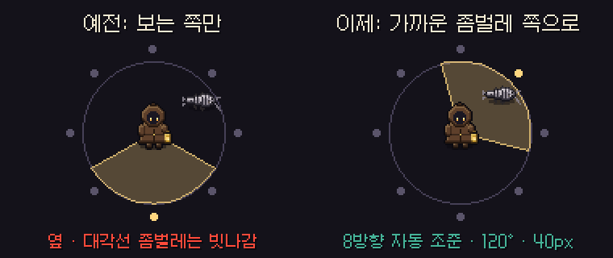
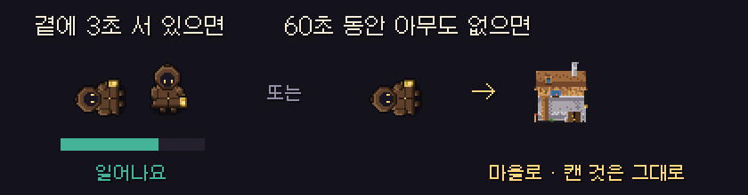

# 딥홀드 v0.4.7 — 폐광산 긴급 수정

**좀벌레가 이제 제대로 맞아요 · 같이 폐광산에서 동료를 살릴 수 있어요**

> [!NOTE]
> 설치형은 게임을 켜면 **자동으로 업데이트**돼요. 같이 폐광산은 모두 **v0.4.7** 이어야 함께 들어갈 수 있어요.

---

## 🐛 좀벌레 치기

- 공격 키를 누르면 **40px 안의 가장 가까운 좀벌레 쪽으로 몸을 돌려** 휘둘러요 (8방향).
- 앞쪽 **120° 부채꼴** 안을 모두 쳐요. 옆 · 대각선 · 뒤에서 다가와도 맞아요.
- 키를 **톡 눌러도 휘두르기는 끝까지** 이어져서 맞는 순간을 놓치지 않아요.

## 🤝 같이 폐광산 살리기

- 같이 폐광산에서 체력이 0이 되면 바로 마을로 가지 않고 **그 자리에 쓰러져요.**
- 동료가 **곁에 3초** 서 있으면 체력 1로 일어나요. 살려 준 동료는 체력 1을 써요.
- **60초 동안 아무도 살리지 않으면** 마을로 돌아가요. 이번에 캔 것은 **그대로** 가져가요.
- 혼자 하는 폐광산은 예전처럼 바로 마을로 돌아가요.

---

## 📊 수치 변경 (v0.4.6 → v0.4.7)

| 항목 | v0.4.6 | v0.4.7 |
| --- | --- | --- |
| 좀벌레 치기 | 보는 쪽 앞만 | **가까운 좀벌레 쪽 자동 조준 · 120° · 40px** |
| 같이 폐광산 쓰러짐 | 바로 마을로 | **3초 살리기 · 60초 뒤 마을로** |

---

확률 · 수치는 **[확률 정보](../docs/확률정보.md)** 에 모두 공개돼 있어요. 버그나 의견은 **[Issues](https://github.com/starMinK/deephold-releases/issues)** 에 남겨 주세요.

[← 패치 노트 목록](README.md) · [v0.4.6 패치 노트](v0.4.6.md)

