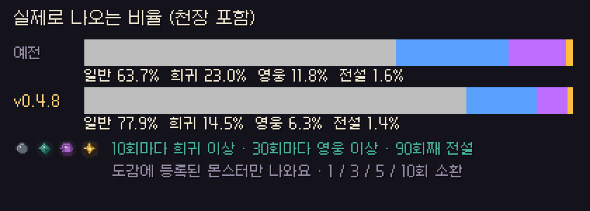
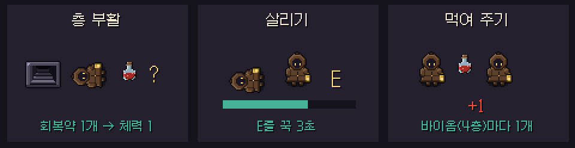
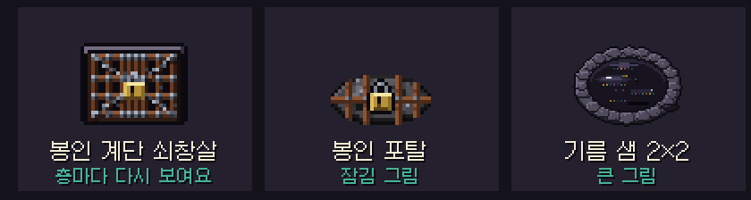
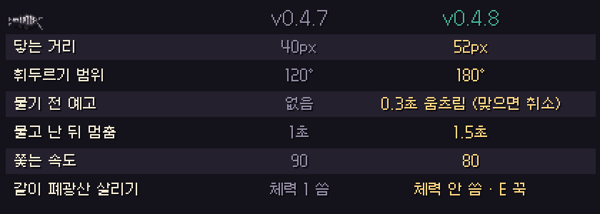

# 딥홀드 v0.4.8 — 소환 · 파티 돌봄 · 던전 규칙

**희귀는 덜, 서로 챙기기는 더, 구르기로 구멍은 못 건너요**

> [!NOTE]
> 설치형은 게임을 켜면 **자동으로 업데이트**돼요. 파티 · 같이 폐광산은 모두 **v0.4.8** 이어야 해요. 이제 버전이 다르면 대기실에 안내가 뜨고 출발이 막혀요.

> [!IMPORTANT]
> **소환 확률과 천장이 바뀌었어요.** 10회마다 희귀 이상, 30회마다 영웅 이상이 확정이고, 도감에 등록된 몬스터만 나와요. 아래 [📊 수치 변경](#-수치-변경-v047--v048)을 확인해 주세요.

---

## 🔮 소환

- 기본 확률이 **일반 82% · 희귀 13% · 영웅 4.8% · 전설 0.2%** 로 바뀌었어요. 희귀가 덜 나와요.
- 천장이 두 단계가 됐어요. **10회마다 희귀 이상**, **30회마다 영웅 이상** 확정이에요. 전설 천장(74회째부터 상승 · 90회째 확정)은 그대로예요.
- **도감에 등록된(1마리 이상 잡은) 몬스터만** 나와요. 그 등급에 등록된 몬스터가 없으면 바로 아래 등급에서 뽑아요.
- 소환 버튼이 **1 · 3 · 5 · 10회** 로 늘었고, 버튼마다 총 비용이 보여요. 혼불이 모자라면 버튼이 잠겨요.

## 🤝 파티 — 서로 챙기기

- **층 부활:** 이제 층을 옮겨도 쓰러진 동료가 저절로 일어나지 않아요. 계단 · 보스 문 · 보스방 출구를 쓸 때 **회복약 1개를 내고 데려갈지** 골라요. 데려가면 다음 층에서 체력 1로 시작해요.
- **살리기:** 쓰러진 동료 곁에서 **상호작용 키를 3초 꾹** 눌러야 살아나요. 지나가다 원하지 않게 살리는 일이 없어요.
- **먹여 주기:** 살아 있는 동료 곁에서 **1초 꾹** 누르면 내 회복약으로 동료 체력을 1 채워 줘요. 한 사람이 받을 수 있는 건 **바이옴(4층)마다 1개** 까지예요.
- **바닥 회복약** 은 이제 주인만 주울 수 있어요.
- 파티 보스 체력이 **모든 페이즈에 똑같이** 늘어나요 (예전엔 1페이즈만 늘었어요). 파티에서도 **3페이즈 등장 화면** 이 나와요.
- 관전할 때 동료의 공격이 막대 대신 **제대로 된 베기 그림** 으로 보여요.

## 🗺 던전

- **구르기로 구멍 · 깊은 물 · 용암을 건널 수 없어요.** 굴러도 땅을 밟는 거예요. (물에 잠긴 왕의 방 발판 사이 물길은 예전처럼 굴러서 건너요.)
- 대신 **무너지는 바닥이 길을 끊지 않아요.** 무너지는 바닥을 하나도 밟지 않고 계단 · 포탈 · 상자 · 기름 샘 · 유물 제단까지 갈 수 있는 길이 항상 있어요. 방과 방을 잇는 통로에는 무너지는 바닥이 없어요.
- **유물 제단** 은 층마다 50% → **30%** 로 나와요.
- **숨은 방 혼불** 은 확정 → **40%** 예요. 상자와 재료는 그대로예요.
- **광부의 직감** 은 이제 숨은 방이 있는 층을 알려 주고 **미니맵에 대략적인 방향** 을 보여 줘요. 문을 빛나게 하는 건 **귀신 램프** 몫이에요. 둘을 같이 가지면 방향을 따라가다 빛나는 문을 찾을 수 있어요.
- 분열해서 나온 **작은 슬라임은 처치 수에 세지 않아요** (도감 · 숙련도 · 해금 · 업적).
- **톱날 함정** 이 몬스터 · 캐릭터 위에 그려져 가리던 문제를 고쳤어요.
- **봉인된 계단 쇠창살** 이 2층부터 안 보이던 문제를 고쳤어요. **봉인된 탈출 포탈** 은 회색 대신 쇠창살 · 자물쇠 그림으로 보여요. 2×2 **기름 샘** 도 큰 그림이 생겼어요.

## 🐛 폐광산 좀벌레

- 맞기는 쉽고 때리기는 어렵던 좀벌레를 조정했어요. **닿는 거리 52px · 휘두르기 180°**, 물기 **0.3초 전에 움츠리는 예고** (그때 치면 물기 취소), 물고 난 뒤 **1.5초** 멈춰요. 조금 느려졌어요 (90 → 80).
- 같이 폐광산에서 동료를 살릴 때 **체력을 쓰지 않아요.** 살리기는 던전처럼 **상호작용 키 꾹** 이에요.

## 🏡 마을 · 편의

- 타이틀 화면과 마을 일시정지 메뉴에 **게임 종료** 버튼이 생겼어요. 원정 중이면 "지금 끄면 사망 처리" 경고가 떠요.
- 큰 마을 지도 옆에 **텔레포트 목록** 이 생겼어요. 올리면 지도에서 빛나고, 누르면 바로 이동해요.
- 마을 **미니맵** 이 틀 안쪽을 꽉 채워요.
- 원정 출발 창에서 **보통 · 쉬움 · 견습 · 연습** 이 각자 자기 설명을 보여 줘요.
- **보스 연습장:** 쉬운 모드에서만 만난 보스는 **1페이즈까지** 연습할 수 있어요. 보통 모드에서 만나면 전부 열려요.
- 보스 연습을 하면 도감의 **연습 횟수** 가 올라가요.

---

## 📊 수치 변경 (v0.4.7 → v0.4.8)

| 항목 | v0.4.7 | v0.4.8 |
| --- | --- | --- |
| 소환 기본 확률 (일반 / 희귀 / 영웅 / 전설) | 69.3 / 25 / 5.1 / 0.6% | **82 / 13 / 4.8 / 0.2%** |
| 소환 천장 | 10회 영웅 이상 | **10회 희귀 이상 · 30회 영웅 이상** |
| 소환 대상 | 모든 몬스터 | **도감에 등록된 몬스터만** |
| 파티 층 부활 | 체력 2로 저절로 | **회복약 1개로 데려가기 (체력 1)** |
| 파티 회복약 먹여 주기 | 없음 | **바이옴마다 1개 받기** |
| 유물 제단 | 층마다 50% | **30%** |
| 숨은 방 혼불 | 확정 | **40%** |
| 구르기로 구멍 · 물 · 용암 | 건널 수 있음 | **건널 수 없음** |
| 좀벌레 (거리 / 범위 / 속도) | 40px / 120° / 90 | **52px / 180° / 80** |

- 예전 리플레이는 **예전 규칙 그대로** 재생돼요.

---

확률 · 수치는 **[확률 정보](../docs/확률정보.md)** 에 모두 공개돼 있어요. 버그나 의견은 **[Issues](https://github.com/starMinK/deephold-releases/issues)** 에 남겨 주세요.

[← 패치 노트 목록](README.md) · [v0.4.7 패치 노트](v0.4.7.md)

