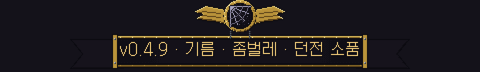
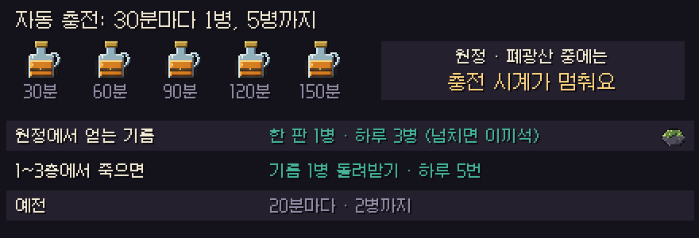
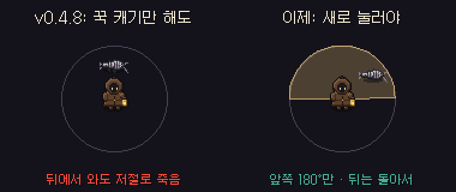
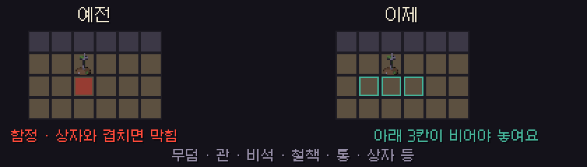

# 딥홀드 v0.4.9 — 기름 · 좀벌레 · 던전 소품

**기름은 쉬는 동안 5병까지, 좀벌레는 직접 쳐야, 무덤은 길을 막지 않아요**

> [!NOTE]
> 설치형은 게임을 켜면 **자동으로 업데이트**돼요. 파티 · 같이 폐광산은 모두 **v0.4.9** 이어야 해요.

> [!IMPORTANT]
> **기름 자동 충전이 30분마다 1병, 5병까지로 바뀌었어요.** 대신 원정 · 폐광산 중에는 충전 시계가 멈춰요.

---

## 🛢 기름

- **자동 충전:** 30분마다 1병, **5병까지** 차요 (예전 20분 · 2병까지). 빈 상태에서 다 차는 데 2시간 30분이에요.
- **원정 · 폐광산 중에는 충전 시계가 멈춰요.** 오래 버틴다고 기름이 저절로 다시 차지 않아요. 나오면 남은 시간부터 이어서 세요.
- **원정에서 얻는 기름** (기름 샘 · 상자) 은 한 판에 1병, 하루 3병까지 기름으로 받아요. 넘치는 몫은 이끼석 20개로 바뀌어요.
- **1~3층에서 죽으면 기름 1병을 돌려받아요.** 하루 5번까지예요. 전리품은 평소처럼 일부 남아요. 던전 포기하기 · 견습 원정 · 탈출은 돌려받지 않아요.
- 정제소 (이끼석 25개 → 1병) 와 폐광산 역청 → 기름은 그대로예요.

## 🐛 좀벌레

- v0.4.8에서는 캐기 키를 꾹 누르고만 있어도 주변 좀벌레를 **어느 방향이든** 저절로 쳐서, 뒤에서 와도 알아서 죽었어요.
- 이제 공격 키를 **새로 눌러야** 휘둘러요. 계속 누르고 캐는 중에는 저절로 휘두르지 않아요.
- 자동으로 몸을 돌리는 건 **바라보는 쪽 앞 180°** (양옆까지) 만이에요. 뒤에서 오는 좀벌레는 직접 돌아서 쳐야 해요.
- 닿는 거리 52px · 범위 180° · 물기 전 0.3초 예고는 그대로예요. **알아채고 누르면 쉽게 맞고, 무시하고 캐기만 하면 물려요.**

## 🪦 던전 소품

- 십자 무덤 · 관 · 비석 · 철책 · 통 · 상자 같은 **막는 소품** 이 길을 막던 문제를 고쳤어요.
- 막는 소품은 이제 **아래 3칸이 모두 빈 바닥** 일 때만 놓여요. 던전을 만들 때 소품을 피해서 계단 · 포탈 · 상자 · 기름 샘 · 유물 제단까지 갈 수 있는지도 확인해요.
- 그래서 소품 수가 예전보다 조금 줄어요. 납작한 바닥 장식은 그대로예요.

## 🔮 광부의 직감

- 미니맵의 '숨은 방 있음' 표시와 방향 화살표가 도형 대신 **반짝이는 보석 · 화살표 그림** 으로 바뀌었어요.

---

## 📊 수치 변경 (v0.4.8 → v0.4.9)

| 항목 | v0.4.8 | v0.4.9 |
| --- | --- | --- |
| 기름 자동 충전 | 20분마다 · 2병까지 | **30분마다 · 5병까지** |
| 원정 · 폐광산 중 충전 | 계속 참 | **멈춤** |
| 원정에서 얻는 기름 | 제한 없음 | **한 판 1병 · 하루 3병** |
| 1~3층 사망 | 기름 잃음 | **돌려받기 (하루 5번)** |
| 좀벌레 자동 치기 | 꾹 누르면 360° | **새로 누를 때 · 앞 180°** |
| 막는 소품 자리 | 북쪽 벽 · 좌우 · 아래 바닥 | **+ 아래 3칸이 빈 바닥** |

- 예전 리플레이는 **예전 규칙 그대로** 재생돼요.

---

확률 · 수치는 **[확률 정보](../docs/확률정보.md)** 에 모두 공개돼 있어요. 버그나 의견은 **[Issues](https://github.com/starMinK/deephold-releases/issues)** 에 남겨 주세요.

[← 패치 노트 목록](README.md) · [v0.4.8 패치 노트](v0.4.8.md)

