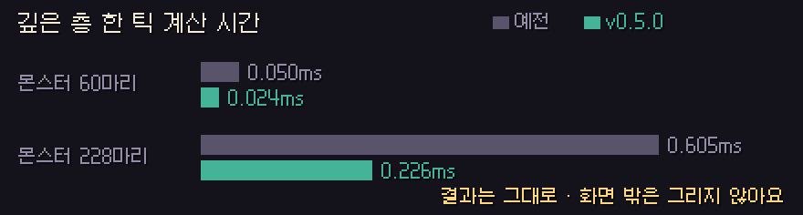
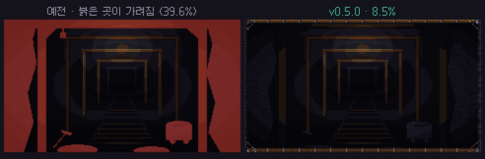

# 딥홀드 v0.5.0 — 파티 렉 · 계정 · 맥

**파티가 덜 끊기고, 깊은 층이 가벼워지고, 계정을 직접 지울 수 있고, 맥에서도 돌아가요**

> [!NOTE]
> 설치형은 게임을 켜면 **자동으로 업데이트**돼요. 파티 · 같이 폐광산은 모두 **v0.5.0** 이어야 해요.

---

## 🌐 파티 렉 개선

- 누군가 원정 기록을 올릴 때 서버가 기록을 확인하느라 **파티 전체가 1~2초씩 멈추던 문제**를 고쳤어요. 확인은 이제 따로 돌아서 파티 중계를 막지 않아요.
- 입력 여유가 **판 도중에도 핑에 맞춰 자동으로** 6~12틱 사이를 오가요. 너무 빡빡하게 잡혀서 버벅이던 일이 줄어요.
- 느려진 쪽이 한꺼번에 따라잡느라 화면이 튀던 것도 줄였어요(한 프레임에 최대 15틱 → **4틱**).
- 깊은 층 계산이 **2~2.7배 빨라졌어요.** 결과는 예전과 똑같아요.
- 화면 밖의 몬스터 · 투사체 · 이펙트는 **그리지 않아요**(계산은 그대로).
- 판 도중 연결이 끊겨도 **9초 안에 다시 붙으면** 같은 방, 같은 순간에서 이어 가요.

## 🪨 폐광산 새 테두리

- 화면 양옆을 크게 가리던 암벽 테두리를 얇은 **나무 들보 · 암벽 틀**로 바꿨어요. 가리는 곳이 **39.6% → 8.5%** 로 줄었어요.
- 폐광산 결과 창에 **게임 종료** 버튼이 생겼어요. 누르면 사망 처리된다는 경고가 먼저 떠요.

## 🗑 계정 삭제

- **설정 → 계정 삭제**에서 직접 지울 수 있어요. 닉네임을 똑같이 입력해야 버튼이 눌려요.
- 지우면 서버의 계정 · 기록 · 친구 · 랭킹 · 내 던전이 바로 사라지고, **되돌릴 수 없어요.**
- 어떤 정보를 얼마나 보관하는지는 **[개인정보 처리방침](../docs/개인정보처리방침.md)** 에 공개했어요.

## 🍎 맥 버전

- **Apple 칩 · Intel 맥**용 dmg가 생겼어요. [최신 릴리스](https://github.com/starMinK/deephold-releases/releases/latest)에서 받으세요.
- 아직 Apple 공증을 받지 않아서, 처음 켤 때는 앱을 **우클릭 → 열기**로 열어야 해요.
- 맥에서는 자동 업데이트 대신 새 버전 받는 곳을 열어 줘요.

## 💬 채팅

- 채팅창을 **마우스 휠 · PageUp/PageDown** 으로 위로 올려 볼 수 있어요. 최근 **100줄**까지 남아요.
- 위를 보고 있을 때 새 말이 오면 **'새 메시지 ↓'** 가 뜨고, 누르면 맨 아래로 가요.

## 🛠 고친 것

- 멈추지 않는 용광로 2페이즈에 거미왕 문구가 뜨던 것 → 보스마다 맞는 문구가 떠요.
- 파티 던전에서 보스 첫 등장 카드가 뜰 때 게임이 멈추던 것 → 멈추지 않아요.
- 동료를 살릴 때 **살리는 사람 머리 위에도 게이지**가 보여요.
- 던전 미니맵 테두리 여백을 맞췄어요.
- 늘어진 덩굴 이끼는 **벽 칸 안에만** 그려져요.
- 내 던전의 소품도 원정과 같은 규칙으로 놓여서 **길을 막지 않아요.**

---

## 📊 수치 변경 (v0.4.10 → v0.5.0)

| 항목 | v0.4.10 | v0.5.0 |
| --- | --- | --- |
| 파티 입력 여유 | 4~12틱 (판 시작 때 한 번) | **6~12틱 (판 도중 자동)** |
| 한 프레임 최대 따라잡기 | 15틱 | **4틱** |
| 판 도중 재접속 | 안 됨 | **9초 안에 이어 가기** |
| 채팅 보관 | 50줄 | **100줄** |
| 폐광산 테두리 가림 | 39.6% | **8.5%** |

- 드롭 · 확률 · 몬스터 수는 **바뀌지 않았어요.** 예전 리플레이도 그대로 재생돼요.

---

확률 · 수치는 **[확률 정보](../docs/확률정보.md)** 에 모두 공개돼 있어요. 버그나 의견은 **[Issues](https://github.com/starMinK/deephold-releases/issues)** 에 남겨 주세요.

[← 패치 노트 목록](README.md) · [v0.4.10 패치 노트](v0.4.10.md)

