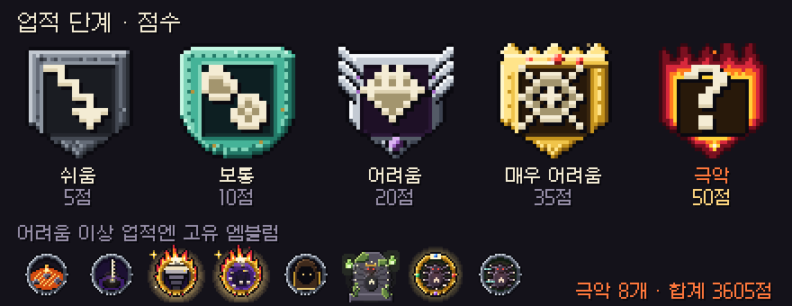
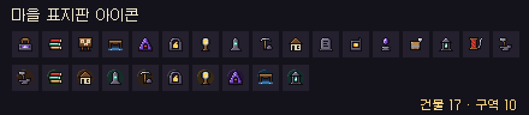

# 딥홀드 v0.5.1 — 업적 5단계 · 시험판 표시 · 폐광산 손질

**업적에 극악 단계와 불꽃 엠블럼이 생기고, 창 크기가 부드럽게 맞춰지고, 폐광산 좀벌레가 돌진해요**

> [!NOTE]
> 설치형은 게임을 켜면 **자동으로 업데이트**돼요. 파티 · 같이 폐광산은 모두 **v0.5.1** 이어야 해요.

---

## 🧪 시험용 게임물 표시

- 딥홀드는 지금 **시험용 게임물**(비공개 시험)이에요. 타이틀 아래쪽과 마을에 표시가 붙어요.
- 처음 켜면 안내 창이 뜨고, **확인**을 눌러야 시작돼요. 안내 문구는 **설정 → 정보**에서 다시 볼 수 있어요.
- 정식 출시(1.0) 때는 규정에 따라 시험 기간의 **기록이 초기화될 수 있어요.**

## 🏅 업적 5단계 · 엠블럼

- 업적 점수를 **5단계**로 다시 매겼어요: 쉬움 5 · 보통 10 · 어려움 20 · 매우 어려움 35 · **극악 50점**.
- 새 **극악** 단계(8개)에는 **불꽃으로 둘러싼 테두리**와 칭호 판이 붙어요. 심연 25 · 30층, 전 보스 무결, 저주 30, 도감 100% 같은 업적이에요.
- 어려움 이상 업적 대부분에 **업적마다 다른 엠블럼**이 생겼어요.
- 달성할 때 등급에 맞는 연출이 나와요.
- 집계가 안 되던 업적 10개를 **이제 집계해요.** 일반 업적 250개, 합계 **3605점**.
- 업적 · 엠블럼은 지금처럼 **보통 모드에서만** 올라요.

## 🖥 창 크기 · 글자

- 창 크기에 맞춰 화면이 **꽉 차게 부드럽게** 커져요. 예전처럼 딱 맞는 배율 + 검은 띠가 좋으면 **설정 → 도트 선명하게(정수배)** 를 켜 주세요.
- **UI 크기**를 바꿔도 창들이 화면 가장자리 기준으로 제자리에 붙어요. 작게에서 HUD 이름판 · 친구 코드 글자가 넘치던 것도 고쳤어요.
- 주민 · 다른 유저 이름표를 작고 깔끔하게(9px) 줄였어요. 가까이 가면 이름 옆에 **E 키**가 떠요.

## 🪧 마을 표지판

- 건물 17곳 · 구역 10곳 표지판에 **아이콘**이 생겼어요.
- 건물 표지판 글자를 키우고, **E 키는 표지판 오른쪽 끝**에 붙였어요.
- 마을 돌다리가 캐릭터를 제대로 **가리지 않던 것**을 고쳤어요.

## 💬 채팅

- 1초에 한 줄로 막던 제한을 바꿨어요. 이제 **연달아 5줄까지** 보낼 수 있고, 1.5초마다 1줄씩 다시 차요.
- 같은 말은 10초 안에 **3번째부터** 막혀요. 계속 도배하면 5초부터 최대 60초까지 막혀요.
- 막혀도 **쓰던 글은 입력칸에 남아요.** 몇 초 남았는지도 보여 줘요.
- 채팅 기록 폭이 고정되고, 긴 말은 줄을 바꾸고, 글자가 조금 작아졌어요. 채팅을 닫으면 '새 메시지 ↓' 가 사라져요.

## ⛏ 폐광산

- **좀벌레가 돌진형으로** 바뀌었어요. 천천히 다가오다 약 5칸 안에서 **0.8초 웅크린 뒤** 직선으로 최대 6칸 돌진해요. 웅크릴 때 치면 돌진이 취소되고, 벽에 부딪히면 1.2초 기절해요. 몸이 닿는 것만으로는 다치지 않아요.
- 블록이 깨질 때 **조각 · 먼지 · 광석 반짝이** 효과가 나와요. 빈 곳에도 곡괭이를 휘두를 수 있어요.
- 블록을 캔 뒤 **같은 종류 블록이 쪼그라들던 것**을 고쳤어요.
- 랜턴 빛 가장자리가 덜 떨리고, 어둠이 더 매끄럽게 그려져요.
- **역청이 자동으로 기름으로 바뀌지 않아요.** 모두 창고에 쌓이고, 기름은 **제련소에서 역청 5개 = 1병**으로 바꿔요. 제련 땔감이 모자라던 문제 때문이에요.

## 🛡 운영

- 운영자가 보낸 **경고**는 게임을 켤 때 창으로 떠요. **정지**된 계정은 시작이 막히고, 정지 중 기록은 올라가지 않아요.

## 🛠 고친 것

- 내 던전 편집 미리보기에 **문 · 봉인 문** 그림이 보여요.
- 화면 밖 판정이 일부 몬스터를 안 그리던 문제를 고쳤어요(던전에도 적용).

---

## 📊 수치 변경 (v0.5.0 → v0.5.1)

| 항목 | v0.5.0 | v0.5.1 |
| --- | --- | --- |
| 업적 단계 | 4단계 (5 · 10 · 15 · 20점) | **5단계 (5 · 10 · 20 · 35 · 50점)** |
| 채팅 보내기 | 1초에 1줄 | **연달아 5줄 · 1.5초마다 1줄 충전** |
| 채팅 도배 막힘 | 고정 | **5 → 60초 (점점 길게)** |
| 역청 → 기름 | 자동 (5개 = 1병) | **제련소에서만 (5개 = 1병)** |
| 좀벌레 | 쫓아와 물기 | **웅크림 0.8초 → 돌진 최대 6칸** |

- 던전 드롭 · 확률 · 몬스터 수는 **바뀌지 않았어요.** 좀벌레 수치는 시험하면서 더 맞출 수 있어요.

---

확률 · 수치는 **[확률 정보](../docs/확률정보.md)** 에 모두 공개돼 있어요. 버그나 의견은 **[Issues](https://github.com/starMinK/deephold-releases/issues)** 에 남겨 주세요.

[← 패치 노트 목록](README.md) · [v0.5.0 패치 노트](v0.5.0.md)

