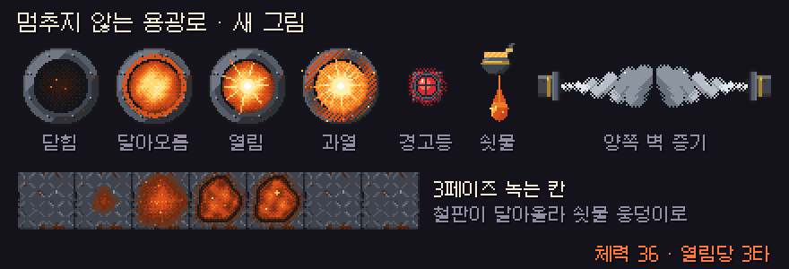
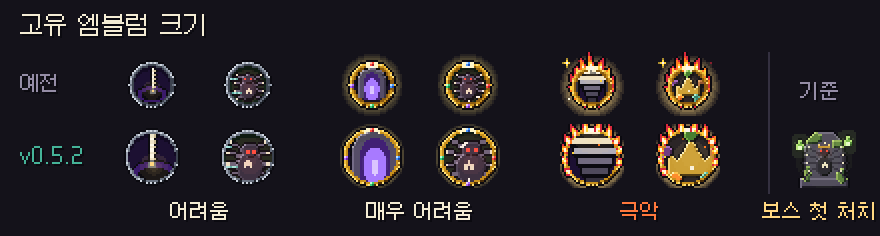

# 딥홀드 v0.5.2 — 용광로 손질

**멈추지 않는 용광로가 더 빠르고 짧고 공정해졌고, 고유 엠블럼이 커졌어요**

> [!NOTE]
> 설치형은 게임을 켜면 **자동으로 업데이트**돼요. 파티 · 같이 폐광산은 모두 **v0.5.2** 이어야 해요.

---

## 🔥 멈추지 않는 용광로

**더 짧고, 더 빠르게**
- 체력 **50 → 36타**. 페이즈마다 12타씩이에요.
- 냉각 밸브 3개를 부수면 화구가 **4초** 열리고, 한 번에 **최대 3타**까지 들어가고, 3타를 맞으면 바로 닫혀요. 남은 타수는 화구 아래에 보여요.
- 공격 사이 숨 고르기가 짧아졌어요(페이즈 1 · 2 · 3: 1.5 · 1.25 · 1.05초 → **1.2 · 0.95 · 0.75초**).
- 밸브가 다시 생길 때마다 **아래쪽 줄의 다른 자리**에 나와요.

**패턴**
- **쇳덩이:** 2페이즈 **4줄** · 3페이즈 **5줄**에서 줄마다 3개씩 간격을 두고 굴러와요. 늘 **1줄 이상은 비어** 있고, 줄마다 조준선이 먼저 떠요.
- **벽 증기:** 가끔 한쪽 벽에서만 나오던 그림을 고쳤어요. 이제 **양쪽 벽**에서 나오고, 안전한 곳은 가운데 한 줄뿐이에요.
- **3페이즈 과열:** 쇳물이 쉬지 않고 쏟아져 피하기 너무 어렵던 것을 바꿨어요.
  - 5초 동안 **2개씩 5묶음**(약 12개 → 10개). 1초마다 한 묶음이 떨어지고, 사이에 짧게 숨 돌릴 틈이 있어요.
  - 묶음마다 1개는 **내 위치**, 1개는 **방 안 아무 곳**이에요.
  - 이미 녹은 칸 · 녹고 있는 칸 · 증기 안전 통로에는 떨어지지 않아요.
  - 마지막 쇳물이 떨어진 **뒤에** 화구가 열려요(3초 · 3타).
- **3페이즈 녹는 칸:** 3초마다 바닥이 녹아요.
- **냉각 밸브 곁 예고:** 밸브 곁에 오래 서 있으면 뜨는 원이 다 차도 **피해가 없던 버그**를 고쳤어요. 이제 다 차면 증기가 터져 **체력 1**을 잃어요(반경 40px). 컨베이어가 거꾸로 도는 것은 그대로예요.

**그림**
- 보스가 **벽 뒤에 가려지던 것**을 고쳤어요.
- 새 그림: 화구(닫힘 · 달아오름 · 열림 · 과열), 컨베이어 경고등, 불 뿜기 바닥 원, 떨어지는 쇳물, 양쪽 벽 증기구.
- 3페이즈 녹는 칸이 밝은 용암 타일 대신 **철판이 달아올라 쇳물 웅덩이가 되는** 그림으로 바뀌었어요.

## 🏅 고유 엠블럼 크기

- v0.5.1의 고유 엠블럼이 보스 첫 처치 엠블럼보다 **훨씬 작아 보이던 것**을 고쳤어요.
- 테두리는 얇게, 가운데 그림은 크게 그렸어요. **좋은 엠블럼일수록 커지고**, 극악은 보스 첫 처치 엠블럼과 같은 크기예요.

## 🛠 고친 것

- 마을 지도에서 건물로 이동할 때 **엉뚱한 자리에 도착하던 것**(저주술사 천막 등)을 고쳤어요. 이제 늘 그 건물 문 앞에 서요.

---

## 📊 수치 변경 (v0.5.1 → v0.5.2)

| 항목 | v0.5.1 | v0.5.2 |
| --- | --- | --- |
| 용광로 체력 | 50타 (남은 33 · 16에서 페이즈 전환) | **36타 (남은 24 · 12에서 전환)** |
| 밸브를 부순 뒤 열림 | 5초 · 타수 제한 없음 | **4초 · 최대 3타** |
| 과열 뒤 열림 | 3초 · 타수 제한 없음 | **3초 · 최대 3타** |
| 공격 사이 (페이즈 1 · 2 · 3) | 1.5 · 1.25 · 1.05초 | **1.2 · 0.95 · 0.75초** |
| 쇳덩이 (2 · 3페이즈) | 2줄 · 3줄, 줄마다 1개 | **4줄 · 5줄, 줄마다 3개** |
| 과열 쇳물 | 0.4초마다 약 12개, 전부 내 위치 | **2개씩 5묶음 = 10개, 절반만 내 위치** |
| 과열 쇳물 퍼짐 | 90px | **105px (무작위는 방 전체)** |
| 3페이즈 녹는 간격 | 4초 | **3초** |
| 밸브 곁 예고 | 피해 없음 | **증기 1 피해 (40px)** |

- 다른 보스 · 드롭 · 확률은 **바뀌지 않았어요.** 예전 리플레이도 그대로 재생돼요.

---

확률 · 수치는 **[확률 정보](../docs/확률정보.md)** 에 모두 공개돼 있어요. 버그나 의견은 **[Issues](https://github.com/starMinK/deephold-releases/issues)** 에 남겨 주세요.

[← 패치 노트 목록](README.md) · [v0.5.1 패치 노트](v0.5.1.md)

