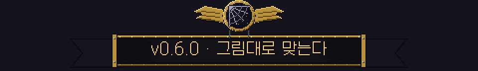
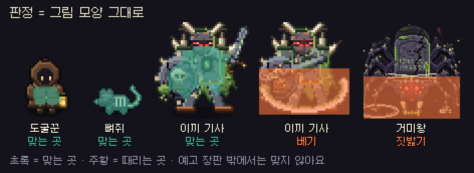
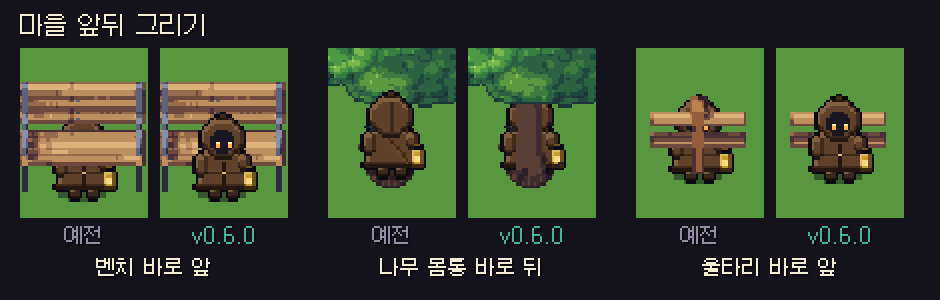

# 딥홀드 v0.6.0 — 그림대로 맞는다

**맞는 곳과 때리는 곳이 그림 모양을 그대로 따르고, 마을의 앞뒤와 건물 충돌이 새로 만들어졌어요**

> [!NOTE]
> 설치형은 게임을 켜면 **자동으로 업데이트**돼요. 파티 · 같이 폐광산은 모두 **v0.6.0** 이어야 해요.

---

## 🎯 판정 개편

예전에는 캐릭터와 공격을 동그라미 · 네모로 어림잡아 판정했어요. 이제 **그림의 픽셀 모양 그대로** 판정해요.

**맞는 곳 (몸)**
- **몬스터:** 몸 그림 전체가 맞는 곳이에요. 일반 몬스터는 예전보다 **약 1.5~2배**, 보스는 **약 2배 넘게** 넓어져서, 보이는 곳을 치면 맞아요.
- **도굴꾼:** 크기는 예전과 거의 같아요. 모양만 그림에 맞췄어요.

**때리는 곳 (공격)**
- 몬스터 공격은 **공격 그림이 닿는 곳**만 때려요. 휘두르는 무기 · 내리찍는 발 같은 모양 그대로예요.
- 바닥에 예고 장판이 뜨는 공격은 **예고 장판 밖에서는 맞지 않아요.** 예고가 보여 준 범위가 곧 맞는 범위예요.
- 예고 없이 휘두르는 근접 공격도 휘두르기 직전 동작이 보여 준 거리만큼만 닿아요(장의사 삽 휘두르기가 조금 짧아졌어요).
- 기절하거나 숨은 몬스터는 몸에 닿아도 **피해를 주지 않아요.**

## 🔥 멈추지 않는 용광로 · 과열 다시

- 3페이즈 과열 때 쇳물 **12개가 쉬지 않고** 떨어져요. 떨어지는 자리는 **내 위치 → 내가 갈 곳 → 내 둘레(40~100px)** 순서로 돌아가요.
- 과열이 끝나도 **화구가 열리지 않아요.** 화구는 냉각 밸브를 부숴서만 열려요.
- 쇳물 원과 불길은 **구르는 동안 지나갈 수 있어요**(구르기 0.4초 내내).

## 🏘 마을 앞뒤 · 건물 충돌

- **앞뒤 그리기:** 건물 · 나무 · 울타리 · 벤치 · 다리 · 절벽이 픽셀마다 앞뒤를 따져 그려져요. 나무 몸통 뒤에 서면 몸통이 나를 가리고, 울타리 바로 앞에 서면 내가 앞에 보여요.
- **건물 충돌:** 건물마다 실제 바닥 모양대로 막혀요. 벽 안으로 파고들거나, 아무것도 없는 곳에서 막히던 자리가 없어졌어요.
- 소환 신전은 계단을 올라가 문 앞에서 들어가고, 기둥 사이로는 지나갈 수 없어요.
- **반투명:** 건물이 나를 **실제로 가릴 때만** 반투명해져요. 게시판처럼 얇은 물체 앞에 바짝 붙어도 흐려지지 않아요. 등불탑 불꽃 · 우물 물빛 · 횃불 · 연기 · 대문 장식도 건물과 함께 고르게 흐려져요.

## 👁 예고 모양 정리

- 피해가 없는 바닥 장식(거미왕 알 · 용암 뱀 웅덩이 · 웅덩이 촉수 물웅덩이 · 익사왕 소환 표시 · 가라앉는 칸)은 이제 **옅은 무늬**로만 보여요. 화면 밖 위험 화살표에도 뜨지 않아요.
- 피해 없이 **감속 · 시야 축소**만 거는 예고(익사자 물웅덩이 · 거미줄 벽 · 기억 포식자 교란 · 속삭이는 그림자)는 **청록색**으로 보여요. 빨강 · 주황 예고는 언제나 피해가 있어요.

## 🔮 소환 비용

- 3회 · 5회 · 10회 소환 비용이 **1회 비용 × 횟수**가 됐어요(예전에는 묶음 안에서도 한 번 뽑을 때마다 값이 올랐어요). 묶음을 다 뽑은 뒤 보유 수가 늘면 다음 소환부터 오른 값이에요.
- 소환 버튼 줄이 창 밖으로 튀어나가던 것을 고쳤어요.

## 🛠 고친 것

- 파티에서 관전할 때 효과음이 **왼쪽에서만** 들리던 것을 고쳤어요. 이제 관전 중인 동료 기준으로 좌우가 나뉘어요.

---

## 📊 수치 변경 (v0.5.3 → v0.6.0)

| 항목 | v0.5.3 | v0.6.0 |
| --- | --- | --- |
| 판정 모양 | 동그라미 · 네모 | **그림 픽셀 모양** |
| 일반 몬스터 맞는 곳 | 코드 동그라미 | **약 1.5~2배** |
| 보스 맞는 곳 | 코드 동그라미 | **약 2.1~2.4배** |
| 도굴꾼 맞는 곳 | 코드 동그라미 | **거의 같음 (약 0.99배)** |
| 예고 장판이 있는 공격 | 예고 밖도 맞을 수 있음 | **예고 안에서만** |
| 용광로 과열 쇳물 | 2개씩 5묶음 = 10개 | **12개 연속** |
| 과열 뒤 화구 | 3초 · 최대 3타 열림 | **열리지 않음** |
| 쇳물 원 · 불길 | 구르기 중에도 맞음 | **구르는 동안 안 맞음** |
| 3 · 5 · 10회 소환 비용 | 뽑을 때마다 오른 값의 합 | **1회 비용 × 횟수** |

- 드롭 · 확률은 **바뀌지 않았어요.** 예전 리플레이는 예전 판정 그대로 재생돼요.

---

확률 · 수치는 **[확률 정보](../docs/확률정보.md)** 에 모두 공개돼 있어요. 버그나 의견은 **[Issues](https://github.com/starMinK/deephold-releases/issues)** 에 남겨 주세요.

[← 패치 노트 목록](README.md) · [v0.5.3 패치 노트](v0.5.3.md)

