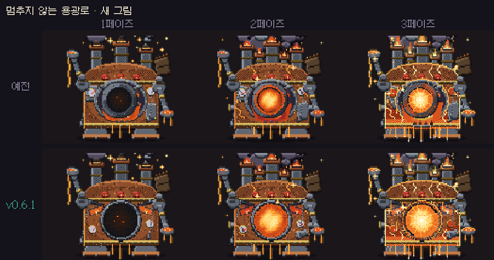
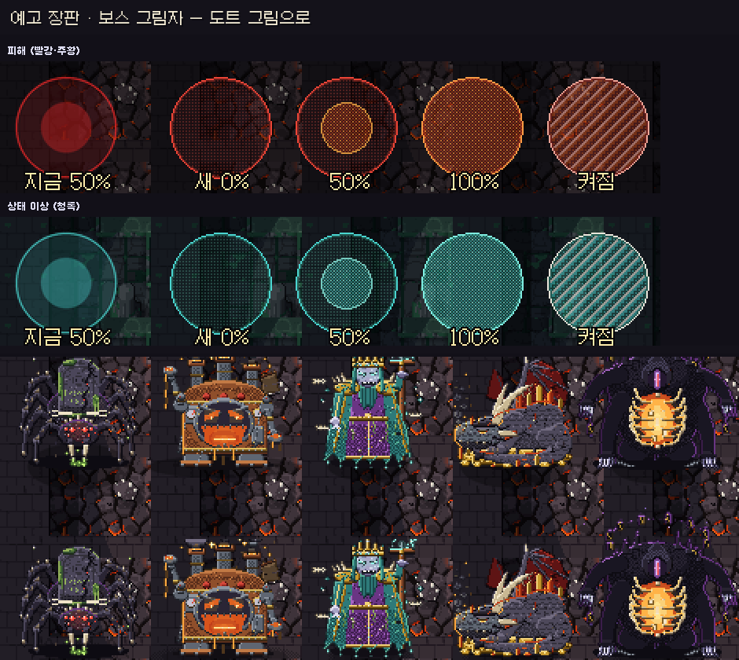

# 딥홀드 v0.6.1 — 피할 수 있는 용광로

**멈추지 않는 용광로를 "보고 피하면 피해지는" 보스로 다시 맞추고, 예고 장판과 보스 그림자를 도트 그림으로 바꿨어요**

> [!NOTE]
> 설치형은 게임을 켜면 **자동으로 업데이트**돼요. 파티 · 같이 폐광산은 모두 **v0.6.1** 이어야 해요.

---

## 🔥 멈추지 않는 용광로 다시 맞춤

용광로는 여전히 2바이옴 첫 보스답게 **어려워요.** 다만 "잘해도 못 피하는" 순간을 없앴어요.

**냉각 밸브 · 증기**
- 밸브를 부순 뒤 뿜어 나오는 **증기 예고가 1.4초로 고정**돼요. 예전에는 깊이에 따라 짧아져서 8층에서는 0.55초뿐이었어요. 예고를 보고 가운데 안전 줄까지 걸어가면 돼요.
- 밸브는 **가운데에서 약 5칸 안**에만 생겨요(예전에는 7칸까지). 먼 밸브는 **바깥으로 미는 컨베이어 위에는 생기지 않아요.**
- 계산으로 확인한 결과, 밸브를 친 순간 **피할 길이 없는 증기가 0곳**이에요(예전 약 67%).

**화구**
- 밸브 3개를 다 부수면 화구가 **5.5초** 열려요(예전 4초). 마지막 밸브에서 화구까지 걸어와도 칠 시간이 남아요. 열릴 때마다 최대 3타는 그대로예요.

**3페이즈 과열**
- 쇳물이 **10개, 0.5초 간격**으로 떨어지고, 한 번에 예고는 **최대 2개**예요(예전 12개 · 0.4초 · 3개).
- 떨어지는 자리는 **내 위치 → 내 둘레** 순서예요. "내가 갈 곳"을 미리 막던 것은 뺐어요.

**새 그림**
- 용광로 몸과 **화구를 다시 그렸어요.** 화구가 몸에 박힌 모양이 되어 보스를 가리지 않고, 몸이 흔들리면 함께 흔들려요. 쓰러지는 동안에는 화구가 사라져요.
- 맞는 곳 · 때리는 곳 판정도 **새 그림 모양**으로 다시 뽑았어요.
- 보스 소개 카드에서 문 · 불빛이 보스를 가리던 것을 고쳤어요.

## 🎨 예고 장판 · 보스 그림자

- 예고 장판(원 · 부채꼴 · 띠)이 **도트 그림**으로 바뀌었어요. 예고가 차오르는 모습이 칸칸이 보이고, 켜지는 순간 테두리가 번쩍여요. 색 규칙은 그대로예요(빨강 · 주황 = 피해, 청록 = 감속 · 시야 축소).
- 용광로 불길 · 쇳물 · 화구 열기는 그을음과 불씨가 있는 **전용 그림**이에요. 예전의 큰 주황 타원이 없어졌어요.
- 보스 5종의 발밑 그림자를 **몸 모양 그대로** 그렸어요(위: 예전 · 아래: v0.6.1). 거미왕은 다리 8개, 용광로는 바닥 띠 모양이에요.

## ⏸ 일시정지 · 리플레이

- 일시정지하면 **애니메이션 · 타이머 · 음악 · 반복 효과음이 모두 멈춰요.** 다시 시작하면 음악이 멈춘 곳부터 이어져요.
- 리플레이를 일시정지하거나 구간을 옮겨도 **화면 · 음악 · 보스 페이즈 · 쇳물 웅덩이가 그 시점에 맞게** 다시 맞춰져요.
- 리플레이 아래 막대를 **H**로 숨기고(화면 아래 가장자리에 마우스를 대면 다시 보여요), **F**로 전체 화면을 켜고 끌 수 있어요. 막대가 보일 때는 보스 체력 막대가 막대 위로 올라가요.
- 예전 버전 리플레이는 예전 판정 그대로 재생돼요.

---

## 📊 수치 변경 (v0.6.0 → v0.6.1)

| 항목 | v0.6.0 | v0.6.1 |
| --- | --- | --- |
| 밸브 증기 예고 | 깊이에 따라 짧아짐 (8층 0.55초) | **1.4초 고정** |
| 밸브 자리 (가운데에서) | 최대 약 7칸 (224px) | **최대 약 5칸 (160px)** · 먼 밸브는 바깥 컨베이어 위 금지 |
| 피할 길 없는 증기 (밸브 450곳 계산) | 약 67% | **0%** |
| 화구 열림 | 4초 · 최대 3타 | **5.5초** · 최대 3타 |
| 과열 쇳물 | 12개 · 0.4초 간격 · 동시 예고 3개 | **10개 · 0.5초 간격 · 동시 예고 2개** |
| 과열 노리는 자리 | 내 위치 → 내가 갈 곳 → 둘레 | **내 위치 → 둘레** |

- 드롭 · 확률은 **바뀌지 않았어요.** 1바이옴과 다른 보스는 그대로예요.

---

확률 · 수치는 **[확률 정보](../docs/확률정보.md)** 에 모두 공개돼 있어요. 버그나 의견은 **[Issues](https://github.com/starMinK/deephold-releases/issues)** 에 남겨 주세요.

[← 패치 노트 목록](README.md) · [v0.6.0 패치 노트](v0.6.0.md)

