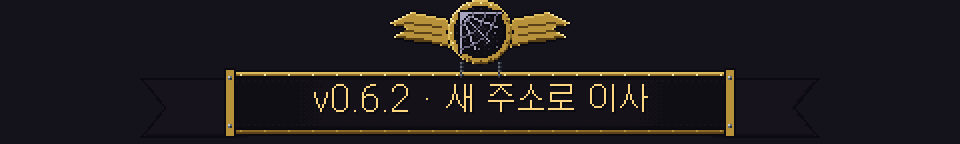

# 딥홀드 v0.6.2 — 새 주소로 이사

**게임 배포 주소가 바뀌었어요. 이번 한 번만 직접 설치해 주세요**

> [!IMPORTANT]
> v0.6.1 이하에서 "버전을 확인하지 못해 게임을 시작할 수 없어요"가 뜨면, 아래 설치 파일을 **한 번만 직접 받아 설치**해 주세요. 기존 게임 위에 덮어 설치되고, 계정 · 진행 상황은 서버에 있어서 그대로예요.
>
> - Windows: [Deephold-Setup-0.6.2.exe](https://github.com/qminlab/deephold-releases/releases/download/v0.6.2/Deephold-Setup-0.6.2.exe)
> - macOS: [Apple 칩](https://github.com/qminlab/deephold-releases/releases/download/v0.6.2/Deephold-0.6.2-mac-arm64.dmg) · [Intel](https://github.com/qminlab/deephold-releases/releases/download/v0.6.2/Deephold-0.6.2-mac-x64.dmg)
>
> 이번 설치 뒤로는 다시 **자동 업데이트**돼요.

---

## 🏠 무엇이 바뀌었나요

- 개발자 GitHub 아이디가 바뀌면서 게임이 새 버전을 확인하던 주소가 끊겼어요. 그래서 v0.6.1 이하 게임이 켜지지 않았어요.
- v0.6.2부터 버전 확인 주소를 **여러 개** 갖고 있어서, 하나가 끊겨도 다른 주소로 확인해요. 앞으로 같은 일로 게임이 막히지 않아요.
- 게임 규칙 · 드롭 · 확률은 **바뀌지 않았어요.** v0.6.1과 같은 게임이에요.

---

버그나 의견은 **[Issues](https://github.com/qminlab/deephold-releases/issues)** 에 남겨 주세요.

[← 패치 노트 목록](README.md) · [v0.6.1 패치 노트](v0.6.1.md)

